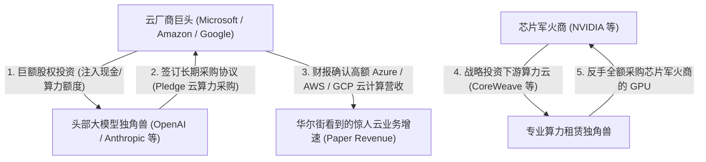
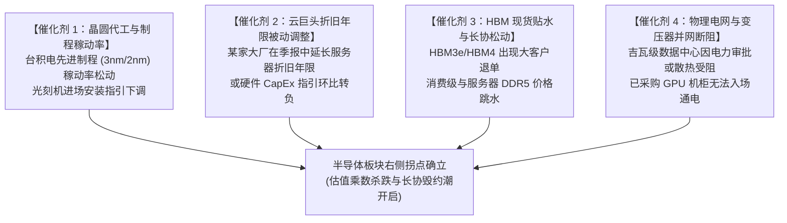

# 第二章：囚徒困境与折旧悬崖：军备竞赛下的自由现金流背离

---

在博弈论的经典图谱中，有一种被称为“美元拍卖（Dollar Auction）”的残酷实验：
拍卖师拿出一张 1 美元的纸币进行竞价，规则极其特殊——出价最高者赢得这 1 美元，但出价第二高的人同样必须支付自己最后报出的金额，且一无所获。

当竞价越过 1 美元的面值后，理性的逻辑便瞬间异化为非理性的绞索。出价 1.1 美元的人宁可承受边际损失，也不愿承担作为第二名被全额扣除本金的巨大沉没成本；紧接着，对手为了不平白损失 1.1 美元，毫不犹豫地将价格推向 1.2 美元、2 美元、5 美元……

最终，一场关于 1 美元的竞逐，演变成了一场双方在沉没成本与博弈威慑下谁也无法率先退出的防御性消耗战。

今天，发生在微软、谷歌（Alphabet）、亚马逊（Amazon）与 Meta 之间的全球 AI 算力军备竞赛，正是这场“美元拍卖”在万亿美元企业资产负债表上的真实重演。

上一章我们看到，资本市场的二阶导已经拉响了估值见顶的防空警报，历史周期的重力正在逼近。按常理，身处漩涡中心的科技巨头应当踩下刹车、收缩资本开支。

然而，现实却展现出一种显著的周期背离：**各大巨头的资本开支（CapEx）不仅没有收敛，反而正在以每年数千亿美元的惊人规模加速攀升，与当期的自由现金流转化效率产生深刻的剪刀差。**

---

## 一、 纳什均衡的死结：为什么巨头明知撞墙也要踩死油门？

要理解这场万亿资本狂飙，首先必须破除一种常见的认知偏差：不要以为这是管理层的盲目冒进。恰恰相反，**这是每个理性参与者在极端博弈模型下所能做出的唯一“占优策略（Dominant Strategy）”。**

对于掌管万亿美元市值的超级科技巨头而言，通用人工智能（AGI）与基础算力基础设施的竞争，从来不是一场普通的“新业务投资收益率（ROI）”核算，而是一场**事关物种存亡的门票战**。

我们可以构建一个简化但极其冷酷的收益矩阵（Payoff Matrix）：

**科技巨头算力军备竞赛收益矩阵（Payoff Matrix）**

| 我方（巨头） \ 对手（竞争者） | 对手：跟进投资 | 对手：缩减开支 |
| :--- | :--- | :--- |
| **我方：跟进投资** | 双方利润率承压，折旧激增<br/>**收益：(-10, -10)** | 我方确立技术代差，赢家通吃<br/>**收益：(+100, -100)** |
| **我方：缩减开支** | 我方彻底落伍，沦为下一个诺基亚<br/>**收益：(-100, +100)** | 行业温和发展，保留充沛自由现金流<br/>**收益：(+20, +20)** |

在这个博弈矩阵中：
- 如果我方选择保守（缩减开支），而对手选择激进跟进，其结果不是净利润下滑几个百分点，而是**致命的不可逆淘汰**——就像智能手机时代的诺基亚（Nokia）、移动搜索时代的雅虎（Yahoo）一样，核心搜索、云计算或社交生态会在数年内被掌握下一代交互界面的对手连根拔起。这种战略溃败的代价是负无穷大（$-\infty$）；
- 如果双方同时疯狂投资，最坏的结果不过是资本回报率（ROIC）下滑、利润表承受数年的高额折旧与利润压缩。但这属于**“活下来以后的阵痛”**；
- 结论是必然的：无论对手如何选择，**“不惜一切代价砸钱买算力、锁定尖端芯片与电力基础设施”**，是每一家巨头首席执行官（CEO）在数学上的唯一理性占优策略。

正如微软、Meta 和谷歌管理层在近几个季度的财报电话会中反复向分析师重申的那句近乎统一的潜台词：
> *“在算力基础设施上的过度投资（Over-investing），其风险远远小于投资不足（Under-investing）。过度投资不过是提前消化产能，而投资不足则意味着直接丧失进入下一个时代的门票。”*

纳什均衡的钢缆，就这样死死勒住了每一家科技巨头的脖子。没有人敢率先松开踩在油门上的脚，系统只能裹挟着全行业，朝着悬崖全速冲刺。

### 1. 地缘战略期权：非纯商业理性的“数字国防开支”
如果仅仅将这场算力狂飙视为纯粹的企业微观商业投资，便无法完全解释为什么连华尔街最精打细算的首席财务官们，也默许了这一令人眩晕的开支曲线。

在现实的地缘政治与国家战略棋局中，算力已经超越了传统科技硬件的范畴，升格为大国竞争核心的“战略威慑底座”。美国《芯片与科学法案》的数百亿美元定向补贴、欧盟对“主权云与主权人工智能（Sovereign AI）”的法案推动，以及各大主要经济体对尖端逻辑芯片出口的严格管治，都在向全球科技巨头传递一个明确的信号：
**算力 CapEx 中有相当一部分，本质上是跨国科技实体向全球数字主权生态所缴纳的“数字国防开支”。**

抢购数十万张尖端芯片、囤积大容量核电购电协议，不仅是为了计算当季在软件端的投入产出比（ROI），更是为了确保在潜在的供应链封锁、地缘冲突乃至下一代技术封锁中，拥有不被瞬间踢出全球核心算力版图的“战略生存期权”。这种超越纯微观商业理性的避险属性，赋予了军备竞赛更深沉的刚性阻尼。

---

## 二、 剪刀差的撕裂：从两千亿到七千亿的万亿算力狂飙

理性博弈推导出的宏观现实，是一组令所有审慎的财务分析师感到窒息的资本开支数据。

![AI 军备竞赛资本开支与折旧悬崖模型](data:image/svg+xml;base64,PHN2ZyB4bWxucz0iaHR0cDovL3d3dy53My5vcmcvMjAwMC9zdmciIHZpZXdCb3g9IjAgMCAxMDAwIDY1MCIgd2lkdGg9IjEwMCUiIGhlaWdodD0iMTAwJSIgc3R5bGU9ImJhY2tncm91bmQtY29sb3I6ICMwZDExMTc7IGZvbnQtZmFtaWx5OiAtYXBwbGUtc3lzdGVtLCBCbGlua01hY1N5c3RlbUZvbnQsICdTZWdvZSBVSScsIFJvYm90bywgSGVsdmV0aWNhLCBBcmlhbCwgc2Fucy1zZXJpZjsiPgogIDwhLS0gVGl0bGUgJiBIZWFkZXIgLS0+CiAgPHRleHQgeD0iNDAiIHk9IjQ1IiBmaWxsPSIjZjBmNmZjIiBmb250LXNpemU9IjIwIiBmb250LXdlaWdodD0iYm9sZCI+QUkg5Yab5aSH56ue6LWb6LWE5pys5byA5pSv5LiO5oqY5pen5oKs5bSW5qih5Z6LIChUaGUgRGVwcmVjaWF0aW9uIENsaWZmKTwvdGV4dD4KICA8dGV4dCB4PSI0MCIgeT0iNzAiIGZpbGw9IiM4Yjk0OWUiIGZvbnQtc2l6ZT0iMTIiPkh5cGVyc2NhbGVycyBDb21iaW5lZCBDYXBFeCB2cy4gQUkgTW9uZXRpemF0aW9uIEFSUiAmYW1wOyBPcGVyYXRpbmcgTWFyZ2luIEltcGFjdCAoMjAyMi0yMDI3RSk8L3RleHQ+CgogIDwhLS0gTGVnZW5kICYgQmFkZ2VzIC0tPgogIDxnIHRyYW5zZm9ybT0idHJhbnNsYXRlKDY4MCwgMjUpIj4KICAgIDxyZWN0IHg9IjAiIHk9IjAiIHdpZHRoPSIyODAiIGhlaWdodD0iNjUiIHJ4PSI2IiBmaWxsPSIjMTYxYjIyIiBzdHJva2U9IiMzMDM2M2QiIHN0cm9rZS13aWR0aD0iMSIvPgogICAgPGNpcmNsZSBjeD0iMjAiIGN5PSIyMiIgcj0iNSIgZmlsbD0iI2Y4NTE0OSIvPgogICAgPHRleHQgeD0iMzIiIHk9IjI2IiBmaWxsPSIjYzlkMWQ5IiBmb250LXNpemU9IjExIj7lm5vlpKfkupHljoLllYblkIjlubYgQ2FwRXggKOi1hOacrOW8gOaUryk8L3RleHQ+CiAgICA8Y2lyY2xlIGN4PSIyMCIgY3k9IjQ1IiByPSI1IiBmaWxsPSIjNThhNmZmIi8+CiAgICA8dGV4dCB4PSIzMiIgeT0iNDkiIGZpbGw9IiNjOWQxZDkiIGZvbnQtc2l6ZT0iMTEiPkFJIOe6r+WinumHj+i9r+S7tiBBUlIgKOW5tOWMlue7j+W4uOaAp+aUtuWFpSk8L3RleHQ+CiAgPC9nPgoKICA8IS0tIENvb3JkaW5hdGUgR3JpZHMgLS0+CiAgPGcgc3Ryb2tlPSIjMjEyNjJkIiBzdHJva2Utd2lkdGg9IjEiIHN0cm9rZS1kYXNoYXJyYXk9IjMsMyI+CiAgICA8bGluZSB4MT0iODAiIHkxPSIxMTAiIHgyPSI5NDAiIHkyPSIxMTAiLz4KICAgIDxsaW5lIHgxPSI4MCIgeTE9IjE4MCIgeDI9Ijk0MCIgeTI9IjE4MCIvPgogICAgPGxpbmUgeDE9IjgwIiB5MT0iMjUwIiB4Mj0iOTQwIiB5Mj0iMjUwIi8+CiAgICA8bGluZSB4MT0iODAiIHkxPSIzMjAiIHgyPSI5NDAiIHkyPSIzMjAiLz4KICAgIDxsaW5lIHgxPSI4MCIgeTE9IjM5MCIgeDI9Ijk0MCIgeTI9IjM5MCIvPgogICAgPCEtLSBEaXZpZGVyIGJldHdlZW4gVHJlbmRzIGFuZCBEJkEgV2F0ZXJmYWxsIC0tPgogICAgPGxpbmUgeDE9IjgwIiB5MT0iNDMwIiB4Mj0iOTQwIiB5Mj0iNDMwIiBzdHJva2U9IiMzMDM2M2QiIHN0cm9rZS1kYXNoYXJyYXk9Im5vbmUiIHN0cm9rZS13aWR0aD0iMS41Ii8+CiAgPC9nPgoKICA8IS0tIFktQXhpcyBMYWJlbHMgKENhcEV4IC8gUmV2ZW51ZSBpbiBCaWxsaW9ucyBVU0QpIC0tPgogIDxnIGZpbGw9IiM4Yjk0OWUiIGZvbnQtc2l6ZT0iMTEiIHRleHQtYW5jaG9yPSJlbmQiPgogICAgPHRleHQgeD0iNzAiIHk9IjExNCI+JDgwMCBCPC90ZXh0PgogICAgPHRleHQgeD0iNzAiIHk9IjE4NCI+JDYwMCBCPC90ZXh0PgogICAgPHRleHQgeD0iNzAiIHk9IjI1NCI+JDQwMCBCPC90ZXh0PgogICAgPHRleHQgeD0iNzAiIHk9IjMyNCI+JDIwMCBCPC90ZXh0PgogICAgPHRleHQgeD0iNzAiIHk9IjM5NCI+JDAgQjwvdGV4dD4KICA8L2c+CgogIDwhLS0gWC1BeGlzIExhYmVscyAoWWVhcnMpIC0tPgogIDxnIGZpbGw9IiM4Yjk0OWUiIGZvbnQtc2l6ZT0iMTEiIHRleHQtYW5jaG9yPSJtaWRkbGUiPgogICAgPHRleHQgeD0iMTMwIiB5PSI0MTUiPjIwMjIgKENoYXRHUFTliY3lpJUpPC90ZXh0PgogICAgPHRleHQgeD0iMjkwIiB5PSI0MTUiPjIwMjMgKOaKouWNoeWGm+Wkh+a9rik8L3RleHQ+CiAgICA8dGV4dCB4PSI0NzAiIHk9IjQxNSI+MjAyNCAofiQyMzVCKTwvdGV4dD4KICAgIDx0ZXh0IHg9IjY1MCIgeT0iNDE1Ij4yMDI1ICh+JDQxM0Ig57+75YCNKTwvdGV4dD4KICAgIDx0ZXh0IHg9IjgzMCIgeT0iNDE1Ij4yMDI2RSAofiQ3NTBCIOeLgumjmSk8L3RleHQ+CiAgPC9nPgoKICA8IS0tIFNoYWRlZCBBcmVhIG9mIFNjaXNzb3IgR2FwIC0tPgogIDxwYXRoIGQ9Ik0gMTMwLDM0NSBRIDI5MCwzMzAgNDcwLDMwNSBUIDY1MCwyNDUgVCA4MzAsMTI1IEwgODMwLDM1MCBRIDY1MCwzNjUgNDcwLDM3NSBUIDI5MCwzODUgVCAxMzAsMzkwIFoiIGZpbGw9IiNkYTM2MzMiIGZpbGwtb3BhY2l0eT0iMC4xMiIvPgoKICA8IS0tIENhcEV4IEN1cnZlIChSZWQsIEV4cG9uZW50aWFsKSAtLT4KICA8cGF0aCBkPSJNIDEzMCwzNDUgUSAyOTAsMzMwIDQ3MCwzMDUgVCA2NTAsMjQ1IFQgODMwLDEyNSIgZmlsbD0ibm9uZSIgc3Ryb2tlPSIjZjg1MTQ5IiBzdHJva2Utd2lkdGg9IjMuNSIvPgogIDwhLS0gQ2FwRXggRGF0YSBQb2ludHMgLS0+CiAgPGNpcmNsZSBjeD0iMTMwIiBjeT0iMzQ1IiByPSI0IiBmaWxsPSIjZjg1MTQ5Ii8+CiAgPGNpcmNsZSBjeD0iMjkwIiBjeT0iMzMwIiByPSI0IiBmaWxsPSIjZjg1MTQ5Ii8+CiAgPGNpcmNsZSBjeD0iNDcwIiBjeT0iMzA1IiByPSI1IiBmaWxsPSIjZjg1MTQ5Ii8+CiAgPHRleHQgeD0iNDcwIiB5PSIyOTUiIGZpbGw9IiNmODUxNDkiIGZvbnQtc2l6ZT0iMTEiIGZvbnQtd2VpZ2h0PSJib2xkIiB0ZXh0LWFuY2hvcj0ibWlkZGxlIj4kMjM1QjwvdGV4dD4KCiAgPGNpcmNsZSBjeD0iNjUwIiBjeT0iMjQ1IiByPSI1IiBmaWxsPSIjZjg1MTQ5Ii8+CiAgPHRleHQgeD0iNjUwIiB5PSIyMzUiIGZpbGw9IiNmODUxNDkiIGZvbnQtc2l6ZT0iMTEiIGZvbnQtd2VpZ2h0PSJib2xkIiB0ZXh0LWFuY2hvcj0ibWlkZGxlIj4kNDEzQjwvdGV4dD4KCiAgPGNpcmNsZSBjeD0iODMwIiBjeT0iMTI1IiByPSI2IiBmaWxsPSIjZjg1MTQ5Ii8+CiAgPHRleHQgeD0iODMwIiB5PSIxMTIiIGZpbGw9IiNmODUxNDkiIGZvbnQtc2l6ZT0iMTIiIGZvbnQtd2VpZ2h0PSJib2xkIiB0ZXh0LWFuY2hvcj0ibWlkZGxlIj4kNzUwQisgKOS4h+S6v+mAvOi/kSk8L3RleHQ+CgogIDwhLS0gQUkgU29mdHdhcmUgQVJSIEN1cnZlIChCbHVlLCBTdWItbGluZWFyIC8gU2xvd2VyIFJhbXApIC0tPgogIDxwYXRoIGQ9Ik0gMTMwLDM5MCBRIDI5MCwzODUgNDcwLDM3NSBUIDY1MCwzNjUgVCA4MzAsMzUwIiBmaWxsPSJub25lIiBzdHJva2U9IiM1OGE2ZmYiIHN0cm9rZS13aWR0aD0iMi41IiBzdHJva2UtZGFzaGFycmF5PSI0LDQiLz4KICA8Y2lyY2xlIGN4PSI0NzAiIGN5PSIzNzUiIHI9IjQiIGZpbGw9IiM1OGE2ZmYiLz4KICA8dGV4dCB4PSI0NzAiIHk9IjM5MiIgZmlsbD0iIzU4YTZmZiIgZm9udC1zaXplPSIxMCIgdGV4dC1hbmNob3I9Im1pZGRsZSI+fiQyNUI8L3RleHQ+CiAgPGNpcmNsZSBjeD0iNjUwIiBjeT0iMzY1IiByPSI0IiBmaWxsPSIjNThhNmZmIi8+CiAgPHRleHQgeD0iNjUwIiB5PSIzODIiIGZpbGw9IiM1OGE2ZmYiIGZvbnQtc2l6ZT0iMTAiIHRleHQtYW5jaG9yPSJtaWRkbGUiPn4kNjBCPC90ZXh0PgogIDxjaXJjbGUgY3g9IjgzMCIgY3k9IjM1MCIgcj0iNCIgZmlsbD0iIzU4YTZmZiIvPgogIDx0ZXh0IHg9IjgzMCIgeT0iMzcwIiBmaWxsPSIjNThhNmZmIiBmb250LXNpemU9IjEwIiB0ZXh0LWFuY2hvcj0ibWlkZGxlIj5+JDEyMEI8L3RleHQ+CgogIDwhLS0gQ2FsbG91dCBmb3IgU2Npc3NvciBHYXAgLS0+CiAgPGcgdHJhbnNmb3JtPSJ0cmFuc2xhdGUoNTYwLCAyOTApIj4KICAgIDxyZWN0IHg9IjAiIHk9IjAiIHdpZHRoPSIxNjAiIGhlaWdodD0iMjYiIHJ4PSI0IiBmaWxsPSIjMWYyNDJjIiBzdHJva2U9IiNmODUxNDkiIHN0cm9rZS13aWR0aD0iMSIvPgogICAgPHRleHQgeD0iODAiIHk9IjE3IiBmaWxsPSIjZjg1MTQ5IiBmb250LXNpemU9IjExIiBmb250LXdlaWdodD0iYm9sZCIgdGV4dC1hbmNob3I9Im1pZGRsZSI+5Ymq5YiA5beu5oyB57ut5omp5aSnICjlt6jkuo/ljovlipspPC90ZXh0PgogIDwvZz4KCiAgPCEtLSBMb3dlciBTZWN0aW9uOiBEJkEgV2F0ZXJmYWxsICYgTWFyZ2luIENvbXByZXNzaW9uIC0tPgogIDxnIHRyYW5zZm9ybT0idHJhbnNsYXRlKDgwLCA0NTApIj4KICAgIDx0ZXh0IHg9IjAiIHk9IjIwIiBmaWxsPSIjZjBmNmZjIiBmb250LXNpemU9IjEzIiBmb250LXdlaWdodD0iYm9sZCI+5oqY5pen5LiO5pGK6ZSAIChEJmFtcDtBKSDngJHluIPlr7nokKXkuJrliKnmtqbnjofnmoTkvrXomoDmnLrliLbvvJo8L3RleHQ+CgogICAgPCEtLSBCbG9jayAxOiBDSVAgLS0+CiAgICA8cmVjdCB4PSIwIiB5PSIzNSIgd2lkdGg9IjI2MCIgaGVpZ2h0PSIxMzUiIHJ4PSI2IiBmaWxsPSIjMTYxYjIyIiBzdHJva2U9IiMzMDM2M2QiIHN0cm9rZS13aWR0aD0iMSIvPgogICAgPHRleHQgeD0iMTUiIHk9IjU4IiBmaWxsPSIjZDI5OTIyIiBmb250LXNpemU9IjExIiBmb250LXdlaWdodD0iYm9sZCI+56ys5LiA6Zi25q6177ya5Zyo5bu65bel56iLIChDSVApPC90ZXh0PgogICAgPHRleHQgeD0iMTUiIHk9Ijc4IiBmaWxsPSIjOGI5NDllIiBmb250LXNpemU9IjEwIj7igKIg6LWE5pys5byA5pSv5YWI6K6w5YWl6LWE5Lqn6LSf5YC66KGoPC90ZXh0PgogICAgPHRleHQgeD0iMTUiIHk9Ijk2IiBmaWxsPSIjOGI5NDllIiBmb250LXNpemU9IjEwIj7igKIg546w6YeR5rWB5rWB5Ye677yM5L2G5LiN5b2x5ZON5b2T5pyf5Yip5ramPC90ZXh0PgogICAgPHRleHQgeD0iMTUiIHk9IjExNCIgZmlsbD0iIzhiOTQ5ZSIgZm9udC1zaXplPSIxMCI+4oCiIOaOqeebluS6huWIneacn+eahOebiOWIqeecn+Wunui0qOmHjzwvdGV4dD4KICAgIDx0ZXh0IHg9IjE1IiB5PSIxNDUiIGZpbGw9IiMzODhiZmQiIGZvbnQtc2l6ZT0iMTAiPueKtuaAge+8mui0pumdouWHgOWIqea2pue5geiNo+WBh+ixoTwvdGV4dD4KCiAgICA8IS0tIEFycm93IDEgLS0+CiAgICA8cGF0aCBkPSJNIDI3MCwxMDIgTCAyOTUsMTAyIiBzdHJva2U9IiM1OGE2ZmYiIHN0cm9rZS13aWR0aD0iMiIgbWFya2VyLWVuZD0idXJsKCNhcnJvdykiLz4KCiAgICA8IS0tIEJsb2NrIDI6IFBQJkUgJiBEJkEgU3Rvcm0gLS0+CiAgICA8cmVjdCB4PSIzMDUiIHk9IjM1IiB3aWR0aD0iMjgwIiBoZWlnaHQ9IjEzNSIgcng9IjYiIGZpbGw9IiMxNjFiMjIiIHN0cm9rZT0iI2Y4NTE0OSIgc3Ryb2tlLXdpZHRoPSIxLjIiLz4KICAgIDx0ZXh0IHg9IjMyMCIgeT0iNTgiIGZpbGw9IiNmODUxNDkiIGZvbnQtc2l6ZT0iMTEiIGZvbnQtd2VpZ2h0PSJib2xkIj7nrKzkuozpmLbmrrXvvJrovazlm7rkuI7mipjml6fmgqzltJYgKDN+NeW5tCk8L3RleHQ+CiAgICA8dGV4dCB4PSIzMjAiIHk9Ijc4IiBmaWxsPSIjYzlkMWQ5IiBmb250LXNpemU9IjEwIj7igKIg5bu6562R5a+/5ZG9MTV+MjDlubQgdnMgR1BV5a+/5ZG95LuFM3415bm0PC90ZXh0PgogICAgPHRleHQgeD0iMzIwIiB5PSI5NiIgZmlsbD0iI2M5ZDFkOSIgZm9udC1zaXplPSIxMCI+4oCiIOavj+W5tOWImuaAp+iuoeaPkOWOn+WAvCAyMCV+MzMlIOe6r+aKmOaXpzwvdGV4dD4KICAgIDx0ZXh0IHg9IjMyMCIgeT0iMTE0IiBmaWxsPSIjZjg1MTQ5IiBmb250LXNpemU9IjEwIj7igKIgJDcwMEIg6LWE5LqnIOKelCDmr4/lubTkuqfnlJ8gJDE1MEIrIOWImuaAp+aKmOaXpzwvdGV4dD4KICAgIDx0ZXh0IHg9IjMyMCIgeT0iMTQ1IiBmaWxsPSIjZjg1MTQ5IiBmb250LXNpemU9IjEwIj7lhrLlh7vvvJrnm7Tlh7vokKXkuJrliKnmtqbooaggKEVCSVQgLyBFQklUREEpPC90ZXh0PgoKICAgIDwhLS0gQXJyb3cgMiAtLT4KICAgIDxwYXRoIGQ9Ik0gNTk1LDEwMiBMIDYyMCwxMDIiIHN0cm9rZT0iIzU4YTZmZiIgc3Ryb2tlLXdpZHRoPSIyIi8+CgogICAgPCEtLSBCbG9jayAzOiBGcmVlIENhc2ggRmxvdyBTcXVlZXplIC0tPgogICAgPHJlY3QgeD0iNjMwIiB5PSIzNSIgd2lkdGg9IjIzMCIgaGVpZ2h0PSIxMzUiIHJ4PSI2IiBmaWxsPSIjMTYxYjIyIiBzdHJva2U9IiNkYTM2MzMiIHN0cm9rZS13aWR0aD0iMS4yIi8+CiAgICA8dGV4dCB4PSI2NDUiIHk9IjU4IiBmaWxsPSIjZGEzNjMzIiBmb250LXNpemU9IjExIiBmb250LXdlaWdodD0iYm9sZCI+56ys5LiJ6Zi25q6177ya6Ieq55Sx546w6YeR5rWB5pat5rWBPC90ZXh0PgogICAgPHRleHQgeD0iNjQ1IiB5PSI3OCIgZmlsbD0iI2M5ZDFkOSIgZm9udC1zaXplPSIxMCI+4oCiIOiHqueUseeOsOmHkea1gSAoRkNGKSDpqqTpmY3ovazotJ88L3RleHQ+CiAgICA8dGV4dCB4PSI2NDUiIHk9Ijk2IiBmaWxsPSIjYzlkMWQ5IiBmb250LXNpemU9IjEwIj7igKIg6KKr6L+r5aSn6KeE5qih5Y+R6KGM5LyB5Lia5YC66J6N6LWEPC90ZXh0PgogICAgPHRleHQgeD0iNjQ1IiB5PSIxMTQiIGZpbGw9IiNjOWQxZDkiIGZvbnQtc2l6ZT0iMTAiPuKAoiDlgJLpgLzokaPkuovkvJrliYrlh4/kuIvkuIDotKLlubQgQ2FwRXg8L3RleHQ+CiAgICA8dGV4dCB4PSI2NDUiIHk9IjE0NSIgZmlsbD0iI2Y4NTE0OSIgZm9udC1zaXplPSIxMCI+57uI5bGA77ya6YCG5ZCR5byV54iG5YWo5Lqn5Lia6ZO+5Y675bqT5a2YPC90ZXh0PgogIDwvZz4KPC9zdmc+Cg==)
*图 2-1：四大云巨头合并资本开支（CapEx）与 AI 纯增量软件收入（ARR）的严重剪刀差趋势，以及资产转固后不可逆的“折旧与摊销（D&A）悬崖瀑布”。*

### 1. 惊人的资本爬坡斜率
审视北美四大云厂商（亚马逊 AWS、微软 Azure、谷歌云 Google Cloud、Meta）自 2022 年大模型爆发以来的合并资本开支轨迹，其斜率之陡峭，超越了历史上任何一次产业基础设施铺设周期：

| 科技巨头 / 财年 | 2024 年实际 CapEx | 2025 年实际 CapEx | 2026 年实际运行与全年预估 (Run-rate) | 核心资金投向 |
| :--- | :--- | :--- | :--- | :--- |
| **亚马逊 (Amazon)** | ~\$780 亿美元 | ~\$1,280 亿美元 | **~\$2,000 亿 - \$2,200 亿美元** | AWS 数据中心扩容、Trainium2/3 自研芯片、Bedrock 基础设施、Talen 核电数据中心园区 |
| **微软 (Microsoft)** | ~\$550 亿美元 | ~\$1,180 亿美元 | **~\$1,750 亿 - \$1,900 亿美元** | OpenAI 算力集群锁单、Azure 尖端节点、Maia 自研算力、Constellation 三里岛核电重启 PPA |
| **谷歌 (Alphabet)** | ~\$530 亿美元 | ~\$910 亿美元 | **~\$1,800 亿 - \$2,050 亿美元** | TPU v6/v7 部署、Gemini 全系推理、Kairos 小型模块化核反应堆 (SMR) 协议 |
| **Meta** | ~\$390 亿美元 | ~\$720 亿美元 | **~\$1,300 亿 - \$1,450 亿美元** | Llama 4/5 超级集群、广告推荐引擎重构、AI 硬件基础设施 |
| **四大巨头合计** | **~\$2,250 亿 - \$2,350 亿美元** | **~\$4,100 亿 - \$4,130 亿美元** | **~\$7,000 亿 - \$7,600 亿美元** | **两年复合增速超 70%，逼近万亿美元关口** |

在短短三年内，四家公司在硬件与基础设施上的年化现金支出，从 2,000 亿美元级别直接暴涨至 **7,000 亿甚至 8,000 亿美元**。

### 2. 资金流向的硬核分解
这数千亿美元并非用于日常办公或软件维护，其超过 **60% 至 75%** 的份额，直接流向了单价极其高昂的算力硬件：
- **尖端计算集群**：英伟达 B200、Blackwell Ultra 以及单机柜功耗达 120 千瓦的 GB200 NVL72 系统，并锁定下一代 Rubin（R100/HBM4）架构产能，加上巨头自研的专用 ASIC（谷歌 TPU v6/v7、亚马逊 Trainium2/3、微软 Maia）；
- **高频网络拓扑**：800G / 1.6T 硅光模块、InfiniBand 交换机与 RoCE 高带宽以太网卡；
- **能源与物理空间**：超大规模数据中心的重型土建、吉瓦级（GW）变电站扩建工程、浸没式与冷板式液冷冷却系统，以及与 Constellation、Talen、Kairos 等能源巨头提前锁定数十年的核电 PPA 与 SMR 小型模块化反应堆购电协议。

### 3. 极度撕裂的“变现剪刀差”
然而，站在天平另一端的，却是平缓得令人不安的商业化变现曲线。

将这数千亿美元的真金白银投入，与下游产生的纯 AI 增量软件年化经常性收入（ARR）进行对比：
- 2024 年全行业纯 AI 软件与云调用增量收入不过 **200 亿至 300 亿美元**；
- 即便到了 2025 与 2026 年，算上企业级 Copilot 订阅、API Token 消耗与大模型搜索广告增益，增量收入乐观估计也仅能爬坡至 **800 亿至 1,200 亿美元** 规模。

**硬件支出的指数级爆炸，遭遇了软件变现的对数级平缓。** 这张巨大的“剪刀差”像一张拉满的弓，正在将全行业的自由现金流绷紧至断裂的边缘。

### 4. 并非破产，而是公用事业化重估：四大巨头的商业博弈异构矩阵与现金牛安全垫
在此处，审慎的长期价值投资者往往会提出一个尖锐的问题：既然资本开支与折旧的剪刀差如此悬殊，科技巨头是否会重演 2000 年互联网泡沫中世通（WorldCom）或安然式的资产负债表猝死？

答案是：**绝不会。今天的科技巨头绝非昔日没有自我造血能力的虚假泡沫，而是人类商业史上现金流最充沛的垄断印钞机。**

微软拥有全球企业生态不可替代的 Windows 与 Office 订阅网络；谷歌统治着数十亿用户的全球搜索与数字广告分发；Meta 掌握着数十亿日活用户的社交帝国与超高转化率的推荐算法；亚马逊坐拥庞大的电商现金飞轮与全球云计算企业基本盘。这四大巨头的成熟传统业务，每年能够稳定产生 **1,000 亿至 2,000 亿美元** 的真金白银经营净现金流。

因此，折旧悬崖引爆的绝非破产倒闭或流动性断裂，而是资本市场对其资产性质的**“公用事业化重估（Multiple De-rating to Utility）”**——从动辄享受 40 倍、50 倍远期市盈率的梦幻高成长科技股，重估为重资产、高折旧、追求稳健现金流的重型数字公用事业运营商（类似于电信运营商或电力电网），其估值乘数将被迫向 18 至 22 倍均值回归。

更重要的是，各家巨头在算力博弈图谱中的脆弱性与防守底牌呈现出极强的**商业异构性（Heterogeneity）**：

| 核心巨头 | 算力商业模式底色 | 核心现金流安全垫 | 核心脆弱点与软肋 | 折旧风暴下的防御姿态 |
| :--- | :--- | :--- | :--- | :--- |
| **英伟达 (NVIDIA)** | 纯粹的“军火卖水人”；轻资产外包代工（台积电），综合毛利率 75%+，赚取全产业链第一波真金白银。 | 无重资产服务器折旧压力；资产负债表趴着数百亿美元净现金，研发敏捷。 | 极度依赖下游前五大客户的 CapEx；一旦大客户削减开支或自研 ASIC 替代，二阶导失速将引发最剧烈的营收腰斩。 | 极度顺周期；顶部高抛回购，试图向全栈软件（CUDA/NIM/Omniverse）延伸以构筑生态黏性。 |
| **微软 (Microsoft)** | “算力分销与转售商”；重金注资绑定 OpenAI，将算力包装为 Copilot 与 Azure AI API 兜售给企业。 | 牢不可破的企业级软件护城河（Office 365, Windows, Teams, Azure 基础设施）；现金流极度充沛。 | 增量 AI 软件 ARR 爬坡过慢；每席位每月 30 美元的订阅面临企业客户缩减人力编制的自我绞杀。 | 攻守平衡；以庞大的传统云服务为掩护分摊硬件成本，但在企业续约率不及预期时面临估值倍数承压。 |
| **Meta** | “开源搅局者与内部降本者”；全面开源 Llama 系列模型，算力几乎百分之百服务于内部广告推荐系统。 | 全球最大的社交广告印钞机（Facebook, Instagram, WhatsApp）；无外部云客户交付 SLA 履约压力。 | 庞大的元宇宙 Reality Labs 持续巨额失血；一旦宏观消费降温拖累广告主预算，双重资本开支压力凸显。 | 防守最敏捷；通过开源瓦解对手的软件收费壁垒，算力转化为广告点击率（CTR）的链路最短、变现最快。 |
| **谷歌 (Alphabet)** | “全栈闭环的守城者”；拥有全球最成熟的自研 TPU 专用算力集群与领先多模态基模能力。 | 全球搜索广告霸权与 YouTube 现金牛；安卓系统垄断移动端分发入口。 | 面临经典的“创新者窘境”：AI 对话式检索正在蚕食高毛利的传统关键词搜索广告位；自研 TPU 无法阻挡推理成本对传统高利润率的侵蚀。 | 被动迎战；必须在不颠覆自身搜索印钞机的前提下完成 AI 引擎替换，防守包袱最为沉重。 |
| **亚马逊 (Amazon)** | “严控成本的基础设施地主”；AWS 主打性价比算力切片，积极部署自研芯片（Trainium/Inferentia）替代英伟达。 | 电商平台飞轮、Prime 订阅会员费与高利润的零售站内广告业务。 | 企业客户在宏观寒风中深度进行“云成本优化（FinOps）”；大模型自研相对滞后，缺乏标志性拳头消费级应用。 | 务实防御；严格按订单节奏投产机柜，资本开支纪律最严苛，受非理性炒作反噬最小。 |

---

## 三、 利润表的倒计时：三到五年的“折旧悬崖”

为什么巨头在 2024 至 2026 年疯狂买卡的同时，当季利润表上的每股收益（EPS）依然能维持亮眼？

这里隐藏着企业会计准则中一个最关键的“时间屏蔽罩”——**资本开支的资本化（Capitalization）与转固时滞。**

### 1. 在建工程（CIP）的财务假面
当微软或谷歌向英伟达开出一张 50 亿美元的芯片采购支票时，这笔钱**在当天并不会计入当期的营业费用（Opex）**。

在会计处理上，它被记为现金流量表中的“购建固定资产支付的现金（CapEx）”，并以**“在建工程（Construction in Progress, CIP）”**的形式静静沉睡在资产负债表的资产端。在算力机房没有完全装配、通电并上线接单（Placed in Service）之前，它对利润表上的营业利润（EBIT）的冲击为零。

这制造了一种极其危险的短期财务繁荣：**现金在汹涌流出，但利润表依然在宣告盈利创历史新高。**

### 2. 物理寿命与折旧周期的致命错配
真正的噩梦始于资产“转固（Transfer to PP&E）”并开始计提折旧的那一刻。

在传统的工业时代，钢筋混凝土厂房、高炉或传统服务器的寿命通常长达 **15 至 20 年**（甚至通用服务器也能折旧 5 至 6 年）。按 20 年折旧，每年计入利润表的折旧费用只有原值的 $5\%$，极其温和。

但 AI 算力硬件的物理与技术规律彻底颠覆了这套游戏规则：
- **严酷的物理老化**：尖端算力 GPU 处于 24 小时满负荷高压运行状态，芯片表面承受着剧烈的热应力震荡（Thermal Cycling）与极高电流密度引发的**电迁移效应（Electromigration）**，高频运转下的硬件物理故障率与能效衰减速度远超传统 CPU；
- **残酷的技术淘汰周期**：半导体架构在算力竞赛下一年一迭代（从 Hopper 到 Blackwell、Blackwell Ultra，再到下一代 Rubin 架构），芯片的计算能效比（Perf/Watt）每 18 个月提升数倍。一颗三年前采购的芯片，其高昂的功耗甚至不足以支撑其产出 Token 的电费。

这导致数据中心内部形成了一道尖锐的折旧周期断层：
- **机房建筑与变电站土建**：折旧周期 **15 ~ 20 年**；
- **算力加速卡、专用 ASIC 与高频光模块**：物理与商业寿命仅有 **3 ~ 5 年**！

**不同资产的折旧侵蚀速度对比**

| 资产类型 | 会计折旧年限 | 每年计入利润表的刚性折旧率 |
| :--- | :--- | :--- |
| 数据中心土建/厂房 | 15 ~ 20 年 | 5% ~ 6.6%（温和） |
| 传统通用服务器 | 5 ~ 6 年 | 16% ~ 20%（可控） |
| 尖端 AI 算力卡/光模块 | 3 ~ 5 年 | **20% ~ 33.3%（极度刚性！）** |

### 3. 折旧瀑布（D&A Waterfall）的利润绞杀
这意味着：**巨头过去两年采购的数百亿美元算力硬件，正以每年原值 20% 至 33% 的惊人比例，刚性地砸向利润表中的“折旧与摊销（Depreciation & Amortization, D&A）”一栏。**

让我们进行一个冷酷的量化推演：
若四大巨头在 2024 至 2026 年间累计沉淀了超过 **1.2 万亿美元** 的算力基础设施资产，假设其中 $60\%$ 为使用寿命 4 年的高密度算力硬件（约 7,200 亿美元）：
$$\text{年化刚性折旧费用} = \frac{7,200 \text{ 亿美元}}{4 \text{ 年}} = 1,800 \text{ 亿美元 / 年}$$

每年光是这批芯片与硬件趴在机房里呼吸，不管有没有客户买单、不管算力有没有被充分调用，利润表上每年都会被动蒸发 **1,800 亿美元的营业利润**！

这就构成了不可避免的**“折旧悬崖”**：一旦宏观经济出现微小扰动，或者下游软件 ARR 增速在某一季度出现横盘，高耸的固定资产折旧将瞬间吞噬巨头原本高达 35%~40% 的营业利润率（Operating Margin），引发 800 至 1,500 个基点的全面利润塌陷。

---

## 四、 循环融资（Circular Economy）的纸面繁荣与击鼓传花

面对日益扩大的剪刀差与逼近的折旧风暴，过去两年里，科技生态演化出了一种极为精巧但极其脆弱的自救把戏——**循环融资（Circular Financing）**。

在传统的商业秩序中，客户购买产品必须基于自身的经营现金流；而在当下的 AI 泡沫中，部分关键现金流却是由供应商自己“左手倒右手”创造出来的：



这一闭环逻辑看似完美：
- 巨头向独角兽注资数十亿乃至上百亿美元现金或等额算力点券；
- 独角兽反手签署长达数年的排他性云计算服务合同；
- 巨头在财报中将这笔资金合规地确认为自身云计算业务的“高速经常性收入（Cloud ARR）”；
- 芯片原厂再通过风险投资部门将利润投资给下游算力租赁商，租赁商拿到钱再全部用来采购原厂的机柜。

**这是典型的由流动性充裕与资本估值溢价所维系的“纸面繁荣（Paper Prosperity）”。**

在流动性宽松、估值单边向上的阶段，这套击鼓传花的把戏能够有效掩盖真实外部终端有效需求的不足。但它存在一个致命弱点：**它极度依赖体系内部的高估值融资能力。**

一旦宏观信贷紧缩、无风险利率居高不下，独角兽在一级市场上的后续融资估值发生停滞，或者监管机构对这种相互嵌套的“关联交易收入”展开实质性审计，这个脆弱的资金回旋镖就会立刻断裂。届时，纸面收入迅速蒸发，留下的只有资产负债表上数百亿美元沉重、冰冷且无法退货的物理硬件债务。

---

## 五、 交易员的透视镜：微观期权伽马挤压与周期反转的 4 大实操监控催化剂

在真实的二级市场交易前线，敏锐的对冲基金与交易员从不等待财报完全出炉才做决策。他们深知，半导体与算力龙头的股价走势，往往会因现代美股独特的**微观衍生品与流动性结构**而脱离基本面极端发酵，但一旦触发右侧信号，反噬也将以极快的速度降临。

### 1. 衍生品武器化：期权伽马挤压（Gamma Squeeze）与波动率放大器
为什么算力龙头在周期冲顶阶段会呈现出违反引力的拔估值暴涨？
除了基本面的乐观预期，核心推手在于**看涨期权（Call Options）的非线性自我强化**：
- **散户与动量资金狂买深度虚值 Call**：在单边狂热市中，大量杠杆资金通过期权市场追逐短期甚至零日到期（0DTE）的虚值看涨期权；
- **做市商（Market Maker）被动进行 Delta 对冲**：卖出看涨期权的做市商为了保持账面风险中性，必须在现货市场上同步买入底层正股。当股价越涨，期权的 Delta 值越大，做市商就**必须在更高的价格被动追买更多正股**，形成了自我实现的螺旋上升；
- **负向 Gamma 的踩踏反噬**：这一机制是一柄双刃剑。一旦股价由于某个偶发因素跌破关键支撑均线（如我们在第一章看到的 20 周均线或 50 日均线），期权的 Delta 值急剧缩水，**做市商会瞬间化身为无情的抛售机器，在市场上以程序化算法抛出天量正股以平仓多余 Delta**。这就是为什么半导体牛市顶部往往在数周内演变为雪崩式放量长阴。

### 2. 右侧交易者的核心武器：周期反转的 4 大实操监控催化剂（Catalyst Checklist）
对于关注右侧交易信号的专业投资者与交易员而言，无须被宏大的叙事迷惑，只需严密盯死以下 4 项具备最高信噪比的硬核催化剂指标：



1. **晶圆代工制程稼动率与设备订单比（Foundry Utilization & WFE Book-to-Bill）**：
   密切跟踪台积电（TSMC）与尖端封测代工厂的季度法说会。一旦 3nm/2nm 先进制程产能利用率从 100%+ 的满载状态出现边际松动，或者 ASML 等光刻巨头在手订单（Bookings）环比下行，表明最上游排产的二阶导已经确立失速；
2. **云巨头会计折旧年限的被动延长（Depreciation Extension）或 CapEx 环比负增长**：
   密切审视四大巨头的 10-Q/10-K 附注。历史上，当科技巨头开始把服务器折旧期由 4 年延长至 5 年甚至 6 年时，正是管理层为了粉饰每股收益（EPS）、掩盖折旧悬崖的最确凿信号；一旦任何一家巨头的季度硬件 CapEx 指引出现环比持平甚至下滑，多头同盟将瞬间瓦解；
3. **高带宽内存（HBM）现货溢价收窄与贴水反转（HBM Spot Discount）**：
   存储器是周期的第一只灵敏金丝雀。当三星、SK 海力士和美光在长协谈判中遭遇云厂商要求“重新议价”，或者现货市场中通用 DDR5 与企业级 SSD 的涨势停滞、转为贴水出清时，牛鞭效应的惩罚便已正式进入倒计时；
4. **吉瓦级物理电网并网阻滞与变压器交付违约（Power Interconnection Bottleneck）**：
   算力不再是纯软件问题，而是电力工程。超大规模数据中心如果由于区域电网审批、高压变压器交付周期（当前长达 2~3 年）受阻而导致工期拖延超过两个季度，沉没在仓库中空转贬值的芯片将成为直接引发上市公司坏账计提的导火索。

### 3. 交易员必须规避的认知陷阱：供给瓶颈假摔、央行流动性兜底与利润池转移

在实际跟踪二阶导与催化剂时，成熟的宏观对冲基金经理还会警惕三重极具迷惑性的“假信号”与缓冲垫：

1. **“供给硬瓶颈（Supply Bottleneck）导致的被动减速”不等同于“需求见顶”**：
   在景气周期的主升浪中，晶圆代工与高端先进封装（如 CoWoS）的产能往往被瞬间打满。当一家芯片巨头的季度营收增速从 250% 回落至 100% 时，在纯数学上二阶导确实为负；但如果此时在手订单（Backlog）与客户预付款创下历史新高，这种减速**纯粹是供给端管道被堵死所造成的“被动假摔”**。一旦新封装厂投产或代工良率阶跃，供给释放会立刻引发业绩的报复性二次加速。机械地在供给受限期做空，极易被新一轮超预期的“Beat & Raise”拉爆仓位；
2. **中央银行的流动性反应函数与巨头万亿股票回购底座**：
   半导体周期不会在货币真空中运行。虽然面对核心通胀黏性与天量国债供给潮，美联储逆势加息并将长端美债推至历史高位，但历史经验表明，一旦科技资产负债表的重估引发系统性金融收紧或失业率跳升，全球央行最终仍可能被迫转向以托底流动性；与此同时，北美科技巨头每年手握超过 500 亿至 1000 亿美元的自由现金流进行激进的**股份回购（Share Buybacks）**，注销巨量存量股本以平滑 EPS。这为资本市场筑起了一道弹性极强的“估值蹦床”，阻断了单边直线崩盘的可能，使周期出清呈现出反复拉锯的复杂形态；
3. **周期出清的常态是“利润池结构性转移”，而非全盘归零**：
   在整个算力基础设施的下半场，博弈的核心往往表现为**从上游“垄断卖水人”向中游“自研 ASIC 平台”的利润池大腾挪**。当英伟达高达 75% 的毛利率遭遇各大云厂商自研芯片（TPU, Trainium, MTIA）的规模化替代时，整个 AI 产业的单位推理成本其实在急剧暴跌，终端应用的繁荣反而因此被大幅激活。投资者必须分清：见顶的究竟是某一家硬件霸主的超额垄断租金，还是整个人类社会的计算生产力进程。

---

## 六、 宏观裂痕对科技树的逆向阻断

如果这套军备竞赛仅仅关在硅谷的象牙塔里，或许还能多维系一段时日。然而，**宏观经济周期的冰冷现实，正在自下而上阻断 AI 基础设施的变现通途。**

宏观经济不是抽象的指标，它由一个个普通家庭的账单与一家家中小企业的月度预算所构成。当前全球宏观环境的裂痕——失业率抬升、实际可支配收入缩水、居民债务利息攀升——正通过企业预算链条，顺着科技树逆向传导：

```
宏观失业率上升 / 居民消费信心下滑
  │
  ▼
传统零售、消费、制造企业终端营收承压
  │
  ▼
企业管理层收紧非核心开支（降本增效、保 EBITDA）
  │
  ▼
技术高管（CIO/CTO）全面叫停“实验性” AI 概念验证（PoC）项目
  │
  ▼
巨头企业级 AI 软件订阅（Copilot）续约率腰斩
  │
  ▼
云厂商软件增量现金流不及预期，被迫下调下一财年硬件 CapEx
```

### 1. 从“恐慌性买单（FOMO）”转向“算细账（Strict ROI）”
在 2023 年狂热期，几乎所有财富 500 强的首席信息官（CIO）都在董事会的逼问下陷入了“不试水 AI 就会被时代淘汰”的焦虑。技术部门可以轻易申请到数百万元的专项预算，用于采购算力、部署大模型概念验证（PoC）项目。

然而，跨入 2025 至 2026 年的宏观深水区，企业的核心任务从“仰望星空与概念验证（PoC）”转向严苛的“真实投入产出比（ROI）审计与防守保命”。

大量的企业在完成为期一年的试用后发现：大模型虽然文采飞扬、写诗画画极佳，但在处理涉及企业真实财务数据、核心ERP流程与极低容错率的精密业务时，其幻觉（Hallucination）与不可预测性带来了极高的工程修复成本。

当被要求拿出清晰的“投资回报率（ROI）”账本时，企业财务官（CFO）的手起刀落：**大量无法量化产出比的 AI 实验性项目在续费期被直接砍掉。** 软件应用层陷入了“概念叫好、实际不续约”的尴尬窘境。

### 2. “按人头计费（Seat-based）”商业模式的天然天花板
目前市场上绝大多数企业级 AI 生产力工具（如每月 30 美元的 Microsoft 365 Copilot、各类代码生成助手），均采用传统的**“按席位/人头计费（Per Seat / Month）”**模式。

这一模式暗含着一个隐性假设：企业的员工基数是稳定或持续扩张的。

然而，在宏观失业率上升、科技与各行各业普遍实行“招聘冻结（Hiring Freeze）”乃至裁员潮的背景下，全社会白领席位的总容量正在被动萎缩。

更具讽刺意味的是：如果 AI 真的像宣传的那样能让一个工程师顶三个人、一个客服替代十个人，那么企业必然会顺理成章地削减人力编制——**而人力编制每削减一个，AI 软件供应商所能收取的按人头订阅费用就会永久性地减少一份。**

技术的自我革命，在商业闭环上竟然构成了对自身订阅天花板的自我绞杀。

---

## 七、 宏观维度的内生悬念：生产力归于机器，消费归于何人？

行文至此，本轮半导体基础设施投资中最关键的微观商业与宏观内生逻辑逐渐清晰：在纳什均衡的囚徒困境下，激进追加 CapEx 是巨头规避技术被颠覆风险的微观占优策略；然而，直线加速的固定资产折旧费用，正与当期自由现金流（FCF）形成日益严峻的剪刀差。巨头们必须在未来数年内，证明这些天文数字般的算力能够创造出足以覆盖沉没成本的全新商业化增量。

为了向股东证明这数千亿美元军备竞赛具备终极合理性，科技界在财报沟通中普遍诉诸于一个宏大的叙事预期：
> *“不要在意短期的折旧与软件订阅波动。AI 最终将替代大部分人类白领与认知劳动，将全社会的边际劳动力成本直接压缩为趋近于零的芯片电费与折旧费。届时，全要素生产率将迎来飞跃，企业利润率将迎来实质性重估。”*

然而，这一套将微观企业降本增效推向极致的商业推演，却在宏观经济学的底层因果中，触发了一个不可忽视的内生张力：

在现代工业经济体系中，**劳动力薪资不仅是企业利润表上的“成本项”，它同时也是全社会宏观总需求（Aggregate Demand）与消费购买力的“核心总源头”。**

如果微观企业竞相通过算法将人类工时与认知决策置换出生产流程：
- 那些在符号劳动与常规白领岗位上面临挤压的普通劳动者，依靠什么来换取持续的收入流？
- 如果普通家庭既难以通过出卖工时获得充分报酬，又未能持有云巨头的资本股权，全社会的终端消费购买力将由谁来托底？
- 当数据中心里的数百万颗 GPU 在纳秒节律中日夜轰鸣，以趋近于零的边际成本生产出浩如烟海的自动化代码、设计图样与商业方案时，**现实市场中究竟有谁，还拥有足够的有效需求，来吸纳并支付这台超级机器所喷涌出的无尽产能？**

维系现代工业社会百年的“福特主义自洽闭环”——即“企业支付体面工资 $\rightarrow$ 工人转化为大众消费者 $\rightarrow$ 消化工业大规模产能”，在边际劳动成本大幅压缩的新技术范式下，正面临着深刻的机制性重构。纯符号类工作的快速大宗商品化，正迫使全社会的价值重心，向着无法被虚拟代码轻易替代的物理现实（Atoms）与法律责任边界全面撤退。
