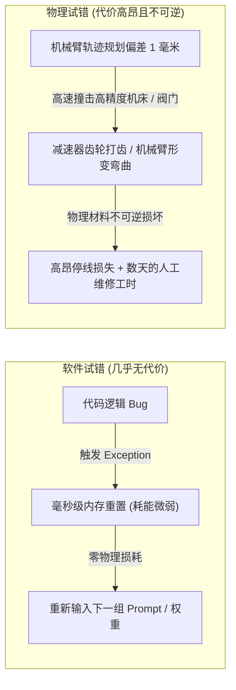

# 第五章：沉重的原子与 Sim-to-Real 鸿沟：物理世界的硬阻尼

---

在计算机图形学与仿真模拟（Simulation）的世界里，建造一个宇宙是极其廉价的。

在英伟达的 Isaac Gym 或由开源物理引擎驱动的 MuJoCo 沙盒中，一名算法工程师只需敲下一行启动指令，上万张显卡便会在虚拟空间中瞬时克隆出数以百万计的机械臂与人形机器人。

在这个纯净的数字宇宙里：
- 重力加速度常数 $g$ 是一个极其精确且均匀的浮点数；
- 刚体碰撞被简化为优雅的拉格朗日多乘子与线性互补问题（LCP）；
- 机器人跌倒、骨折、撞毁一万次，在计算层面仅仅是一次内存指针的重置（Reset），耗时不过几毫秒，消耗的能量不过几毫焦耳。

短短几天时间，虚拟机器人就可以在数字沙盒里“活过”长达数十万年的物理时间，穷尽所有的强化学习动作策略，动作流畅得如同杂技大师。

然而，当工程师满怀信心地将这套在仿真世界里千锤百炼的神经网络权重，烧录进一台价值百万美元、真正站立在水泥地面上的实体机器人时，灾难总会毫无悬念地降临：

实体机器人要么在迈出第一步时便因电机瞬间力矩脉冲过大而剧烈颤抖、关节自激震荡；要么在试图抓取一个普通茶杯时，因桌面微小的毫米级倾斜与微观摩擦力突变，直接将茶杯捏得粉碎，甚至把自己的碳纤维手指撞成昂贵的机械残渣。

这便是所有现代具身智能与机器人工程师心中永远的痛——**仿真到现实的鸿沟（Sim-to-Real Gap）**。

算法的欲望可以在比特世界里无限狂飙，但现实世界的物理法则，早已用最冰冷、最沉重的**“原子”**，筑起了一道深不见底的热力学叹息之墙。

---

## 一、 比特的轻盈与原子的沉重：不可模拟的微观现实

为什么在屏幕里能够写出超人类代码的大模型，在现实中却拧不好一颗生锈的螺丝钉？

因为数字世界是人类大脑抽象出来的“无损模型”，而现实物理世界是基于热力学定律运行的“高维连续耗散场”。在这两个世界之间，横亘着三道无法通过纯粹增加浮点运算量来抹平的本质断层：

![图 5-1：具身智能的 Sim-to-Real 鸿沟与热力学阻尼相图](data:image/svg+xml;base64,77u/PHN2ZyB4bWxucz0iaHR0cDovL3d3dy53My5vcmcvMjAwMC9zdmciIHZpZXdCb3g9IjAgMCAxMDAwIDYwMCIgd2lkdGg9IjEwMCUiIGhlaWdodD0iMTAwJSIgc3R5bGU9ImJhY2tncm91bmQtY29sb3I6ICMwZDExMTc7IGZvbnQtZmFtaWx5OiAtYXBwbGUtc3lzdGVtLCBCbGlua01hY1N5c3RlbUZvbnQsICdTZWdvZSBVSScsIFJvYm90bywgc2Fucy1zZXJpZjsiPgogIDx0ZXh0IHg9IjQwIiB5PSI0NSIgZmlsbD0iI2YwZjZmYyIgZm9udC1zaXplPSIyMCIgZm9udC13ZWlnaHQ9ImJvbGQiPuWFt+i6q+aZuuiDveeahCBTaW0tdG8tUmVhbCDpuL/msp/kuI7ng63lipvlrabpmLvlsLznm7jlm74gKOWbviA1LTEpPC90ZXh0PgogIDx0ZXh0IHg9IjQwIiB5PSI3MCIgZmlsbD0iIzhiOTQ5ZSIgZm9udC1zaXplPSIxMiI+U2ltdWxhdGlvbiBTYW5kYm94IChCaXRzKSB2cy4gVGhlcm1vZHluYW1pYyBIYXJkIERhbXBpbmcgb2YgSGVhdnkgQXRvbXM8L3RleHQ+CiAgCiAgPCEtLSBMZWZ0IEJveDogRGlnaXRhbCBTcGFjZSAtLT4KICA8ZyB0cmFuc2Zvcm09InRyYW5zbGF0ZSg1MCwgMTAwKSI+CiAgICA8cmVjdCB4PSIwIiB5PSIwIiB3aWR0aD0iNDEwIiBoZWlnaHQ9IjQ2MCIgcng9IjgiIGZpbGw9IiMxNjFiMjIiIHN0cm9rZT0iIzM4OGJmZCIgc3Ryb2tlLXdpZHRoPSIxLjIiLz4KICAgIDx0ZXh0IHg9IjI1IiB5PSIzNSIgZmlsbD0iIzM4OGJmZCIgZm9udC1zaXplPSIxNCIgZm9udC13ZWlnaHQ9ImJvbGQiPuaVsOWtl+S7v+ecn+epuumXtCAoQml0cyAvIOiZmuaLn+aymeebkik8L3RleHQ+CiAgICAKICAgIDxnIHRyYW5zZm9ybT0idHJhbnNsYXRlKDI1LCA2MCkiPgogICAgICA8cmVjdCB4PSIwIiB5PSIwIiB3aWR0aD0iMzYwIiBoZWlnaHQ9IjcwIiByeD0iNiIgZmlsbD0iIzIxMjYyZCIgc3Ryb2tlPSIjMzAzNjNkIiBzdHJva2Utd2lkdGg9IjEiLz4KICAgICAgPHRleHQgeD0iMjAiIHk9IjI4IiBmaWxsPSIjZjBmNmZjIiBmb250LXNpemU9IjEyIiBmb250LXdlaWdodD0iYm9sZCI+R1BVIOeJqeeQhuW8leaTjiAoSXNhYWMgR3ltIC8gTXVKb0NvKTwvdGV4dD4KICAgICAgPHRleHQgeD0iMjAiIHk9IjUwIiBmaWxsPSIjOGI5NDllIiBmb250LXNpemU9IjExIj7lubbooYwgMTAsMDAwIOS4queOr+Wig++8jOavj+enkuWIt+WHuuaVsOS6v+atpeaKk+WPluS4juW5s+ihoeiuree7gzwvdGV4dD4KICAgIDwvZz4KICAgIAogICAgPGcgdHJhbnNmb3JtPSJ0cmFuc2xhdGUoMjUsIDE1MCkiPgogICAgICA8cmVjdCB4PSIwIiB5PSIwIiB3aWR0aD0iMzYwIiBoZWlnaHQ9IjcwIiByeD0iNiIgZmlsbD0iIzIxMjYyZCIgc3Ryb2tlPSIjMzAzNjNkIiBzdHJva2Utd2lkdGg9IjEiLz4KICAgICAgPHRleHQgeD0iMjAiIHk9IjI4IiBmaWxsPSIjZjBmNmZjIiBmb250LXNpemU9IjEyIiBmb250LXdlaWdodD0iYm9sZCI+55CG5oOz5Yia5L2T5Yqo5Yqb5a2m5YGH5a6aPC90ZXh0PgogICAgICA8dGV4dCB4PSIyMCIgeT0iNTAiIGZpbGw9IiM4Yjk0OWUiIGZvbnQtc2l6ZT0iMTEiPuaXoOaRqeaTpueqgeWPmOOAgeaXoOadkOaWmeWxiOacjeaegemZkOOAgeeUteejgeeUteacuuaXoOWxgOmDqOa4qea8gjwvdGV4dD4KICAgIDwvZz4KICAgIAogICAgPGcgdHJhbnNmb3JtPSJ0cmFuc2xhdGUoMjUsIDI0MCkiPgogICAgICA8cmVjdCB4PSIwIiB5PSIwIiB3aWR0aD0iMzYwIiBoZWlnaHQ9IjcwIiByeD0iNiIgZmlsbD0iIzIxMjYyZCIgc3Ryb2tlPSIjMzAzNjNkIiBzdHJva2Utd2lkdGg9IjEiLz4KICAgICAgPHRleHQgeD0iMjAiIHk9IjI4IiBmaWxsPSIjZjBmNmZjIiBmb250LXNpemU9IjEyIiBmb250LXdlaWdodD0iYm9sZCI+5oql6ZSZ5Luj5Lu35p6B5L2OIChUaHJvdyBFeGNlcHRpb24pPC90ZXh0PgogICAgICA8dGV4dCB4PSIyMCIgeT0iNTAiIGZpbGw9IiM4Yjk0OWUiIGZvbnQtc2l6ZT0iMTEiPuacuuaisOiHguaSnuepv+WimeWjgeS7hea2iOiAl+aVsOavq+eTpuaXtu+8jOW+ruenkue6p+mHjee9ruWkjeS9jSAoUmVzZXQpPC90ZXh0PgogICAgPC9nPgogICAgCiAgICA8ZyB0cmFuc2Zvcm09InRyYW5zbGF0ZSgyNSwgMzMwKSI+CiAgICAgIDxyZWN0IHg9IjAiIHk9IjAiIHdpZHRoPSIzNjAiIGhlaWdodD0iOTAiIHJ4PSI2IiBmaWxsPSIjMWYyNDJjIiBzdHJva2U9IiMzODhiZmQiIHN0cm9rZS13aWR0aD0iMSIvPgogICAgICA8dGV4dCB4PSIyMCIgeT0iMjgiIGZpbGw9IiMzODhiZmQiIGZvbnQtc2l6ZT0iMTIiIGZvbnQtd2VpZ2h0PSJib2xkIj7mnKzkvZPkuI7pgLvovpHlvbvlupXop6PogKYgKFJNQSDmjaLku7YpPC90ZXh0PgogICAgICA8dGV4dCB4PSIyMCIgeT0iNTAiIGZpbGw9IiM4Yjk0OWUiIGZvbnQtc2l6ZT0iMTEiPuKAoiDnrpfms5XpqbvnlZnlnKjkupHnq6/vvIzmr6vml6DniannkIbmrbvkuqHmgZDmg6c8L3RleHQ+CiAgICAgIDx0ZXh0IHg9IjIwIiB5PSI2OCIgZmlsbD0iIzhiOTQ5ZSIgZm9udC1zaXplPSIxMSI+4oCiIOWkluiuvuWPquaYr+eDreaPkuaLlOa2iOiAl+WTge+8jOaXoOmcgOa8lOWMluaVrOeVj+aEnzwvdGV4dD4KICAgIDwvZz4KICA8L2c+CgogIDwhLS0gTWlkZGxlIERpdmlkZXIgLyBCYXJyaWVyOiBUaGUgU2ltLXRvLVJlYWwgQ2hhc20gLS0+CiAgPGcgdHJhbnNmb3JtPSJ0cmFuc2xhdGUoNDc1LCAxMDApIj4KICAgIDxsaW5lIHgxPSIyNSIgeTE9IjIwIiB4Mj0iMjUiIHkyPSI0NDAiIHN0cm9rZT0iI2Y4NTE0OSIgc3Ryb2tlLXdpZHRoPSIyIiBzdHJva2UtZGFzaGFycmF5PSI2LDQiLz4KICAgIDxyZWN0IHg9Ii0xMCIgeT0iMjAwIiB3aWR0aD0iNzAiIGhlaWdodD0iNzAiIHJ4PSI2IiBmaWxsPSIjMWYyNDJjIiBzdHJva2U9IiNmODUxNDkiIHN0cm9rZS13aWR0aD0iMS41Ii8+CiAgICA8dGV4dCB4PSIyNSIgeT0iMjMwIiBmaWxsPSIjZjg1MTQ5IiBmb250LXNpemU9IjExIiBmb250LXdlaWdodD0iYm9sZCIgdGV4dC1hbmNob3I9Im1pZGRsZSI+U2ltLXRvLVJlYWw8L3RleHQ+CiAgICA8dGV4dCB4PSIyNSIgeT0iMjUwIiBmaWxsPSIjZjg1MTQ5IiBmb250LXNpemU9IjExIiBmb250LXdlaWdodD0iYm9sZCIgdGV4dC1hbmNob3I9Im1pZGRsZSI+54Ot5Yqb5a2m5pat5bGCPC90ZXh0PgogIDwvZz4KCiAgPCEtLSBSaWdodCBCb3g6IFBoeXNpY2FsIFJlYWxpdHkgLS0+CiAgPGcgdHJhbnNmb3JtPSJ0cmFuc2xhdGUoNTQwLCAxMDApIj4KICAgIDxyZWN0IHg9IjAiIHk9IjAiIHdpZHRoPSI0MTAiIGhlaWdodD0iNDYwIiByeD0iOCIgZmlsbD0iIzE2MWIyMiIgc3Ryb2tlPSIjZjg1MTQ5IiBzdHJva2Utd2lkdGg9IjEuMiIvPgogICAgPHRleHQgeD0iMjUiIHk9IjM1IiBmaWxsPSIjZjg1MTQ5IiBmb250LXNpemU9IjE0IiBmb250LXdlaWdodD0iYm9sZCI+55yf5a6e54mp55CG5a6e5L2TIChBdG9tcyAvIOWGt+mFt+WOn+WtkCk8L3RleHQ+CiAgICAKICAgIDxnIHRyYW5zZm9ybT0idHJhbnNsYXRlKDI1LCA2MCkiPgogICAgICA8cmVjdCB4PSIwIiB5PSIwIiB3aWR0aD0iMzYwIiBoZWlnaHQ9IjcwIiByeD0iNiIgZmlsbD0iIzIxMjYyZCIgc3Ryb2tlPSIjMzAzNjNkIiBzdHJva2Utd2lkdGg9IjEiLz4KICAgICAgPHRleHQgeD0iMjAiIHk9IjI4IiBmaWxsPSIjZjBmNmZjIiBmb250LXNpemU9IjEyIiBmb250LXdlaWdodD0iYm9sZCI+6Z2e57q/5oCn5b6u6KeC5pGp5pOm5Yqb5LiO6IOM6ZqZPC90ZXh0PgogICAgICA8dGV4dCB4PSIyMCIgeT0iNTAiIGZpbGw9IiM4Yjk0OWUiIGZvbnQtc2l6ZT0iMTEiPuW6k+S7keaRqeaTpuWQhOWQkeW8guaAp++8jOWHj+mAn+acuuW+ruexs+m9v+mameWcqOWKoOmAn+aXtuS6p+eUn+W8uumYtui3g+mch+mipDwvdGV4dD4KICAgIDwvZz4KICAgIAogICAgPGcgdHJhbnNmb3JtPSJ0cmFuc2xhdGUoMjUsIDE1MCkiPgogICAgICA8cmVjdCB4PSIwIiB5PSIwIiB3aWR0aD0iMzYwIiBoZWlnaHQ9IjcwIiByeD0iNiIgZmlsbD0iIzIxMjYyZCIgc3Ryb2tlPSIjMzAzNjNkIiBzdHJva2Utd2lkdGg9IjEiLz4KICAgICAgPHRleHQgeD0iMjAiIHk9IjI4IiBmaWxsPSIjZjBmNmZjIiBmb250LXNpemU9IjEyIiBmb250LXdlaWdodD0iYm9sZCI+54Ot5Yqb5a2m56ys5LqM5a6a5b6L5LiO5LiN5Y+v6YCG56Oo5o2fPC90ZXh0PgogICAgICA8dGV4dCB4PSIyMCIgeT0iNTAiIGZpbGw9IiM4Yjk0OWUiIGZvbnQtc2l6ZT0iMTEiPumHkeWxnueWsuWKs+OAgeiwkOazouWHj+mAn+WZqOaflOi9ruaWreijguOAgeeUteWIt+ejqOaNn++8jOaXoOazleiiq+KAnOaSpOmUgOKAnTwvdGV4dD4KICAgIDwvZz4KICAgIAogICAgPGcgdHJhbnNmb3JtPSJ0cmFuc2xhdGUoMjUsIDI0MCkiPgogICAgICA8cmVjdCB4PSIwIiB5PSIwIiB3aWR0aD0iMzYwIiBoZWlnaHQ9IjcwIiByeD0iNiIgZmlsbD0iIzIxMjYyZCIgc3Ryb2tlPSIjMzAzNjNkIiBzdHJva2Utd2lkdGg9IjEiLz4KICAgICAgPHRleHQgeD0iMjAiIHk9IjI4IiBmaWxsPSIjZjg1MTQ5IiBmb250LXNpemU9IjEyIiBmb250LXdlaWdodD0iYm9sZCI+5oql6ZSZ5Luj5Lu35p6B5bqm5piC6LS1IChGYXRhbCBDcmFzaCk8L3RleHQ+CiAgICAgIDx0ZXh0IHg9IjIwIiB5PSI1MCIgZmlsbD0iIzhiOTQ5ZSIgZm9udC1zaXplPSIxMSI+5py65qKw6IeC6K+v5pKe5py65Y+w6YCg5oiQ5Yeg5Y2B5LiH5YWD5p6E5Lu25oql5bqf77yM5bm25a+86Ie05pW057q/5YGc5bel57u05L+uPC90ZXh0PgogICAgPC9nPgogICAgCiAgICA8ZyB0cmFuc2Zvcm09InRyYW5zbGF0ZSgyNSwgMzMwKSI+CiAgICAgIDxyZWN0IHg9IjAiIHk9IjAiIHdpZHRoPSIzNjAiIGhlaWdodD0iOTAiIHJ4PSI2IiBmaWxsPSIjMWYyNDJjIiBzdHJva2U9IiNmODUxNDkiIHN0cm9rZS13aWR0aD0iMSIvPgogICAgICA8dGV4dCB4PSIyMCIgeT0iMjgiIGZpbGw9IiNmODUxNDkiIGZvbnQtc2l6ZT0iMTIiIGZvbnQtd2VpZ2h0PSJib2xkIj7plb/lsL7lt6XkuJrmmpfnn6Xor4YgKERhcmsgS25vd2xlZGdlKTwvdGV4dD4KICAgICAgPHRleHQgeD0iMjAiIHk9IjUwIiBmaWxsPSIjOGI5NDllIiBmb250LXNpemU9IjExIj7igKIg5peg5rOV5Zyo5Yeg5byg5Zu+54mH5Lit6KKr5aSn5qih5Z6L5qCH5rOo55qE6Kem6KeJ5omL5oSfPC90ZXh0PgogICAgICA8dGV4dCB4PSIyMCIgeT0iNjgiIGZpbGw9IiM4Yjk0OWUiIGZvbnQtc2l6ZT0iMTEiPuKAoiDniannkIbkuJbnlYznmoTlnZrlm7rlpJblo7PvvIzlsIYgQUkg55qE5omp5byg54ug54ug5Y2h5Zyo546w5a6ePC90ZXh0PgogICAgPC9nPgogIDwvZz4KPC9zdmc+)
*图 5-1：具身智能的 Sim-to-Real 鸿沟与热力学阻尼相图*

**数字仿真空间（Bits）vs. 真实物理现实（Atoms）**

| 物理维度 | 数字仿真沙盒（MuJoCo/Isaac） | 真实物理世界（Reality） |
| :--- | :--- | :--- |
| 接触力学 | 理想几何截面、光滑库仑摩擦 | 微观粗糙度、粘弹性微观咬合、局部瞬态形变 |
| 参数精度 | IEEE 754 浮点数（32 位/64 位绝对准确） | 热噪声、电阻温漂、机械背隙、不可测容差 |
| 时间推进 | 时钟节拍由 CPU 按需单步推进（可暂停） | 连续、不可逆的热力学时间箭头流逝 |
| 报错代价 | 抛出 Exception，毫秒级内存重置 | 机械断裂、停线检修、不可逆的物理熵增 |

### 1. 接触力学（Contact Mechanics）的物理黑洞
在经典力学中，我们习惯将两个物体的接触抽象为一个点或一个面。但若将放大镜推入微观尺度（微米与纳米级），任何看似光滑的金属或橡胶表面，全都是如同阿尔卑斯山脉般崎岖不平的微观凹凸体（Asperities）。

当一个机械爪接触物体时，真实的物理接触面积可能连表观几何面积的千分之一都不到：
- 真实的微观摩擦力不是一个简单的摩擦系数 $\mu$ 乘以正压力 $N$；它涉及到微观粗糙峰的弹性形变、塑性流动、接触界面分子的范德华力以及表面氧化膜的瞬态破裂；
- 在微秒级的抓取瞬态中，微观滑动会导致局部的接触应力急剧震颤，产生无法解析预测的瞬态摩擦跃迁。

在仿真世界中，我们为了保证算法在有限时间内收敛，必须将这些复杂的固态力学细节强制粗粒化（Coarse-grained）为简化的数学惩罚项；
然而，在现实物理世界中，正是这些被算法当作“微不足道白噪声”过滤掉的微观细节，决定了机械臂是平稳端起水杯，还是打滑失手造成事故。

### 2. 机械背隙、热膨胀与传感器的现实容差
软件工程师习惯了代码在每一次运行中产生完全确定性的输出：$1 + 1$ 永远等于 $2$。

但现实物理机械是一个充满**容差（Tolerance）与漂移**的粗糙系统：
- 哪怕是世界上精度最高的减速器（如谐波减速器或 RV 减速器），齿轮啮合处也天然存在不可消除的**微小机械间隙（Backlash）**；
- 机器人连续运转两小时后，电机发热（达到 60℃~80℃）会导致铝合金连杆产生数十微米的热膨胀，导致末端执行器的绝对坐标发生物理偏移；
- 传感器永远伴随着高斯噪声与不可消除的微秒级传输延迟，真实世界的电压瞬变与电磁干扰（EMI）会在信号线上随机叠加毛刺。

现实世界没有“绝对精度”，只有在混沌、噪声与公差泥潭中艰难维持的动态平衡。

### 3. 微观与宏观的阻尼同构：从晶体管量子漏电到机械臂关节颤动

如果我们将视线从宏观机械臂骤然缩小十亿倍，拉入几纳米尺度的先进制程芯片内部，你会惊异地发现：**半导体制造工程师所经历的痛苦，与机器人具身工程师所遭遇的阻尼，在物理本质上是完全同构的。**

软件开发者习惯于在无摩擦的纯逻辑世界中构建算法；但一旦这些逻辑试图在现实介质中运行，物理宇宙那层充满耗散与噪声的“脏质感”就会立刻显露无遗：
- **微观晶格层面的现实阻尼**：当先进制程逼近 2nm/1nm 时，晶体管栅极氧化层只有几个硅原子的厚度。电子不再老老实实听从经典电磁学的指令开关，而是以薛定谔波函数的概率直接“隧穿”绝缘层，产生不可遏止的静态漏电流；极紫外光刻（EUV）中的随机光子散粒噪声（Stochastic Noise），导致光刻线边缘天然存在纳米级的粗糙度（Line Edge Roughness）；铜互连线细到几十纳米时，电子在导线侧壁发生剧烈的散射与电迁移，产生恐怖的焦耳热。
- **宏观机械层面的现实阻尼**：当机械臂试图执行微米级装配时，减速器齿面在润滑油膜破裂瞬间发生金属微焊与撕裂，电机线圈在脉冲大电流下产生热漂移，刚性连杆在受到高频反作用力时激发机械谐振。

从本质上看，**芯片微观层面的“量子隧穿与热色散壁垒”，与机械臂宏观层面的“非线性摩擦与材料疲劳”，是热力学定律在不同尺度上的同一种投射**。
物理世界从来不是一张光滑干净的数学草稿纸。现实是一个由离散原子相互挤压、不断振动、时刻受到热噪声侵蚀的非平衡态耗散系统。任何试图在物理现实中展开智能与计算的系统，都必须老老实实向原子层面的物理摩擦支付昂贵的热力学代价。

---

## 二、 试错成本的不对称性：物理世界的不可逆熵增

纯代码开发之所以能在过去三十年以指数级速度扩散至全球，核心在于其试错的边际物理成本趋近于零：
程序员写出一段导致死循环的代码，操作系统捕获异常，抛出错误日志，耗能几毫瓦时；重新修改两行代码再次编译，整个过程不改变外部物理世界的任何微观状态。

**然而，在现实物理世界中，每一次物理动作，都受制于热力学第二定律的铁律——它是一个产生不可逆熵增的过程。**



在微秒级的伺服控制闭环中，如果一个具身多智能体策略输出了一组微小的异常力矩指令：
- 它不是在屏幕上打印一个报错字符，而是让一台重达上百公斤的工业机器人，以数米每秒的速度**高速撞击在精密铸造模具或高压输油管道上**；
- 伴随着一声金属撕裂的巨响，代价是数万美元的伺服电机抱死烧毁、高刚度碳纤维连杆断裂，以及整个生产流水线长达数天乃至数周的非计划停线。

这种试错代价的物理不对称性，彻底封杀了强化学习在现实世界中进行暴力“堆量”的可能性：
你无法在现实中跑 100 亿次机械碰撞来让机器人“摸索”怎么走路——因为在跑到第 1,000 次时，所有的机械臂早已在金属疲劳与轴承点蚀中彻底化为一堆报废的废铁。

物理世界对愚蠢和粗糙施加着极其昂贵且迅速的物理惩罚。这决定了具身智能在现实中的扩散速度，必然比纯大模型在网络空间中的蔓延，慢上整整几个数量级。

---

## 三、 机体不可分解性 vs. 外设可插拔：为什么机器不懂“敬畏”

在上一章中，我们提到 AI 智能体缺乏对死亡的恐惧与对物理绝境的敬畏。当这种算法被装载进机械躯体时，这种缺乏敬畏的本质，在工程架构上展现为**“本体锁死”与“外设可插拔”的拓扑割裂**。

### 1. 硅基系统的热插拔解耦性（RMA Architecture）
在现代机器人与自动化工厂的架构设计中，身体是被当作消耗品外设来定义的：
- 一根机械臂断裂了，工业机器人控制系统会立刻报错并紧急切断供电；
- 驻厂运维工程师在半小时内拆下报废的机械臂，从库房推出来一套全新的现场可换单元（Field Replaceable Unit, FRU），拧紧高强度螺栓，重新标定零位；
- 与此同时，驱动这根机械臂的核心模型参数、状态记忆日志与控制策略，毫发无损地备份在机房的固态硬盘或远程云端。

对算法而言，身体的毁灭与肢解，不过是资产负债表上的一个部件返修事件（RMA）与边际折旧损耗。它的“自我”从未在这个物理肢体中真正驻留过，它随时可以附身在下一具流水线上下来的标准躯壳之上。

### 2. 碳基人类的机体不可分解性（Somatic Identity）
而人类肉身遵循着一种完全不同的、残酷得多的物理架构：
人类没有“可热插拔”的外设。我们的视觉感受器（视网膜）、信息总线（脊髓神经束）、算力中枢（大脑皮层）以及能量代谢泵（心脏血液循环），在物理结构与生物化学上被高度锁死在一个**不可解耦的单一连续生命体**中。

```
【生物肉身锁死 vs. 硅基外设热插拔】

  碳基人类 (机体一体化)：
  [大脑神经网络] <──(不可分割的生化神经轴突)──> [手脚执行机构与痛觉受体]
         │
         ▼ (一旦发生严重物理损毁)
  [神经元永久损伤 / 机体不可逆消亡] ──▶ 实体不可逆损坏 (严苛的物理出清)

  硅基具身 (控制与外设解耦)：
  [云端策略权重 / 日志备份] ──(以太网/总线协议通信)── [可替换的机械伺服关节]
         │
         ▼ (哪怕机械臂粉碎性撞毁)
  [更替硬件 FRU / 重新标定零位] ──▶ 算法毫发无损 (仅产生微小维护费用)
```

人类的痛觉不是算法中的一个惩罚标量；痛觉是机体在向意识发出最后通牒：**如果破坏继续进行，整个计算实例与意识体验将面临物理宇宙层面的永久湮灭。**

正是因为人类的机体是不可解耦、不可备份、不可逆损坏的，人类工人和工程师在物理现场才会展现出那种深植于本能中的**审慎、警惕与物理直觉**——老车工在车床主轴发出异常啸叫的千分之一秒内会本能地向后闪避，维修工在推入高压电闸前会反复三次核对接地线。

一个由外设构成的机器可以学会模仿人类的动作，但只要它的核心意志与肉身物理损毁保持解耦，它就永远无法演化出人类那种建立在死亡恐惧基础上的真正物理责任感。

---

## 四、 物理暗知识的黑匣子：没有被数字化的现实

大语言模型能够在过去几年取得惊天突破，其前提是人类在过去三十年里，极其慷慨地把文明累积的大部分文字、书籍、网页与代码，以近乎免费的方式进行了全量数字化，喂进了互联网这个超级数据池中。

然而，在物理世界的深处，支配着现代工业体系运转的绝大部分关键知识，**根本没有被写成任何文字或代码。**

它们是以**“物理暗知识（Physical Dark Knowledge）”**的形式，沉淀在千千万万经验老道的工程师、钳工、调试员与操作工的肌肉记忆与触觉手感之中的：
- **微观阻尼的“手感”**：  
  安装高精密轴承时，螺栓拧入的扭矩扳手刻度固然重要，但老师傅在最后转动半圈时感受到的那一丝阻尼与弹性形变回馈，直接决定了轴承在数千转高速旋转下的寿命是三个月还是十年；
- **声学与热学的非言明感知**：  
  大型化工反应釜或重型柴油机出现故障前兆时，最初的异常既不在仪表的数字曲线上，也不在传感器的报警阈值内；它表现为机壳表面一阵细微的次声波共振、润滑油散发出的某种焦糊气味，或是冷却管路表面凝结水珠的微小分布变化；
- **极端边际工况下的即兴妥协**：  
  现实工地上的钢构件发生微小焊接变形时，图纸无法给出答案；工人需要根据当天的气温、钢板的微观应力取向，用火焰局部加热、用千斤顶强行校正，在公差边缘达成一种精妙的工程妥协。

这些沉睡在物理世界中的“暗知识”，无法通过网络爬虫（Web Crawler）抓取，也无法通过合成文本自动生成。

要获取这些知识，AI 必须制造出数以千万计的高灵敏度物理探针，在现实世界漫长的岁月冲刷中，去实打实地承受每一次材料磨损、每一次振动、每一次热应力衰变。

**物理世界的现实容差，是一块坚硬而漫长的磨刀石。** 它绝不可能像软件世界迭代 App 那样，在一两年内被算法一键推平。

---

## 五、 认知维度的内生转向：从工程阻尼到状态机本质

分析至此，现实世界给狂热的算法崇拜浇下了一盆冷静的冷水：物理世界充满了微观接触摩擦、材料热疲劳、工程容差与高昂的现实试错成本。这一堵沉重的“物理硬阻尼之墙”，将具身智能在现实中的落地速率，牢牢锚定在材料科学与机械动力学的客观节律之中。

面对物理世界难以穷举的数据采集成本，当下亦有观点寄望于通过“纯合成数据（Synthetic Data）与模型自对弈”来绕开现实物理世界。然而，根据统计物理与非平衡态热力学规律，一个缺乏来自真实物理外部世界负熵流输入的封闭系统，终将走向方差发散与模型自噬（Model Autophagy）。

退后一步跳出具体的机械臂与伺服电机细节，用纯粹的物理学与信息论眼光重新审视这台机器：
驱动它们运转的，是半导体晶格中的电子漂移与麦克斯韦方程；引导算法演化的，是因果转移矩阵与状态概率更新。

这促使我们不得不重新思考一个更底层的本体论命题：
我们建造的这台由规则驱动、吞吐能量、不断在微观晶格与宏观原子间更新状态的机器——**它在本质上，到底和我们身处其中的物理宇宙有什么区别？**

如果宇宙底层的微观演化本就遵循着严密的离散规则，如果因果关系的宏观涌现正是微观动力学的不可逆展开，那么，我们便需要彻底破除对算法的目的论拟人化执念，从数字物理学的客观视角出发，审视这台在相空间中按部就班自指展开的“无目的状态机”。
