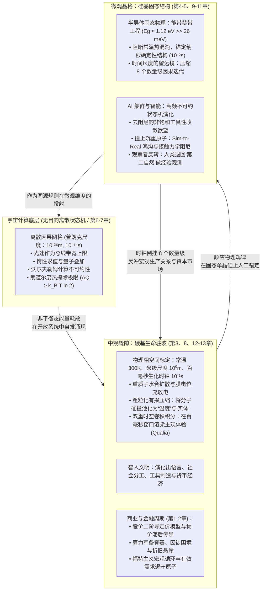

# 第十四章：尾声：在波澜中自洽的驻波

---

合上厚重的技术报表，关掉闪烁不定的行情终端，让我们长长地舒一口气。

当这趟横跨宏观金融学、微观经济学、机器人学、数字物理学、计算复杂性、固态能带工程与认知神经科学的漫长思想苦旅终于抵达终点时，我们终于可以站在最辽阔的群山之巅，回望本文最初向我们迎面抛来的那个看似极其世俗、却又牵动着全人类神经的起点：

**“半导体见顶了吗？”**

在经历了整整十三章层层剥茧、多米诺骨牌式的硬核推演之后，今天，我们终于拥有了最完整、最自洽、也最平静的底气，给出本文的终极答案。

这个答案，不再是一句简单的“是”或“否”，而是分裂成了两个截然不同、却又在更高维度上完美统一的物理面向。

---

## 一、 两个维度的终极回答

![图 14-2：溪流中的巨石与自洽旋转的驻波全景图](data:image/svg+xml;base64,77u/PHN2ZyB4bWxucz0iaHR0cDovL3d3dy53My5vcmcvMjAwMC9zdmciIHZpZXdCb3g9IjAgMCAxMDAwIDYwMCIgd2lkdGg9IjEwMCUiIGhlaWdodD0iMTAwJSIgc3R5bGU9ImJhY2tncm91bmQtY29sb3I6ICMwZDExMTc7IGZvbnQtZmFtaWx5OiAtYXBwbGUtc3lzdGVtLCBCbGlua01hY1N5c3RlbUZvbnQsICdTZWdvZSBVSScsIFJvYm90bywgc2Fucy1zZXJpZjsiPgogIDx0ZXh0IHg9IjQwIiB5PSI0NSIgZmlsbD0iI2YwZjZmYyIgZm9udC1zaXplPSIyMCIgZm9udC13ZWlnaHQ9ImJvbGQiPua6qua1geS4reeahOW3qOefs+S4juiHqua0veaXi+i9rOeahOmpu+azouWFqOaZr+WbviAo5Zu+IDE0LTIpPC90ZXh0PgogIDx0ZXh0IHg9IjQwIiB5PSI3MCIgZmlsbD0iIzhiOTQ5ZSIgZm9udC1zaXplPSIxMiI+Q29zbWljIFJpdmVyLCBUaGUgTWVzb3Njb3BpYyBCb3VsZGVyLCBhbmQgVGhlIFNlbGYtQ29uc2lzdGVudCBEaXNzaXBhdGl2ZSBTdGFuZGluZyBXYXZlPC90ZXh0PgogIAogIDwhLS0gRmxvdyBMaW5lcyAoQmFja2dyb3VuZCBTdHJlYW0pIC0tPgogIDxnIHN0cm9rZT0iIzIxMjYyZCIgc3Ryb2tlLXdpZHRoPSIxLjUiIHN0cm9rZS1kYXNoYXJyYXk9IjgsNiI+CiAgICA8bGluZSB4MT0iNTAiIHkxPSIxMzAiIHgyPSI5NTAiIHkyPSIxMzAiLz4KICAgIDxsaW5lIHgxPSI1MCIgeTE9IjE4MCIgeDI9Ijk1MCIgeTI9IjE4MCIvPgogICAgPGxpbmUgeDE9IjUwIiB5MT0iNDUwIiB4Mj0iOTUwIiB5Mj0iNDUwIi8+CiAgICA8bGluZSB4MT0iNTAiIHkxPSI1MDAiIHgyPSI5NTAiIHkyPSI1MDAiLz4KICA8L2c+CiAgPHRleHQgeD0iODAiIHk9IjE1MCIgZmlsbD0iIzU4YTZmZiIgZm9udC1zaXplPSIxMiIgZm9udC1zdHlsZT0iaXRhbGljIj7lhajlroflrpnkuI3lj6/nuqbnirbmgIHmnLrnrpflipvmtKrmtYEgKOe6s+enkuaZtuagvOW+ruingua8lOWMliDinpQg5aWU5ZCR5LiN5Y+v6YCG54Ot5Yqb5a2m54a15aKeKTwvdGV4dD4KCiAgPCEtLSBMZWZ0OiBUaGUgU2lsaWNvbiBMYXR0aWNlIC0tPgogIDxnIHRyYW5zZm9ybT0idHJhbnNsYXRlKDYwLCAyMjApIj4KICAgIDxyZWN0IHg9IjAiIHk9IjAiIHdpZHRoPSIyNjAiIGhlaWdodD0iMTkwIiByeD0iOCIgZmlsbD0iIzE2MWIyMiIgc3Ryb2tlPSIjZjg1MTQ5IiBzdHJva2Utd2lkdGg9IjEuMiIvPgogICAgPHRleHQgeD0iMjAiIHk9IjMwIiBmaWxsPSIjZjg1MTQ5IiBmb250LXNpemU9IjEzIiBmb250LXdlaWdodD0iYm9sZCI+5b6u6KeC5Zu65oCB56GF5pm25qC8ICjlv6vlj5jph48pPC90ZXh0PgogICAgPHRleHQgeD0iMjAiIHk9IjUwIiBmaWxsPSIjOGI5NDllIiBmb250LXNpemU9IjEwIj7ml7bpkp/vvJoxMOKBu+KBuSDnp5IgKOe6s+enkue/u+i9rCk8L3RleHQ+CiAgICA8dGV4dCB4PSIyMCIgeT0iNzUiIGZpbGw9IiNjOWQxZDkiIGZvbnQtc2l6ZT0iMTEiPuKAoiDog73luKbnpoHluKblt6XnqIvplJrlrprnoa7lrprmgKflraTlsps8L3RleHQ+CiAgICA8dGV4dCB4PSIyMCIgeT0iOTUiIGZpbGw9IiNjOWQxZDkiIGZvbnQtc2l6ZT0iMTEiPuKAoiDml7bpl7TmnJvov5zplZzmm7/lroflrpnmjqjmvJTlm6Dmnpw8L3RleHQ+CiAgICA8dGV4dCB4PSIyMCIgeT0iMTE1IiBmaWxsPSIjYzlkMWQ5IiBmb250LXNpemU9IjExIj7igKIg5LiH5Y2h6ZuG576k54uC6aOZ5o6o5Yqo6LWE5pys5LqM6Zi25a+8PC90ZXh0PgogICAgPHRleHQgeD0iMjAiIHk9IjE0NSIgZmlsbD0iI2Y4NTE0OSIgZm9udC1zaXplPSIxMSIgZm9udC13ZWlnaHQ9ImJvbGQiPuWVhuS4muWRqOacn+ingemhtu+8jOeJqeeQhuWuh+WumeS7juacquingemhtu+8gTwvdGV4dD4KICAgIDx0ZXh0IHg9IjIwIiB5PSIxNjUiIGZpbGw9IiM4Yjk0OWUiIGZvbnQtc2l6ZT0iMTAiPuWQjOa6kOinhOWImeWcqOabtOiHtOWvhuaZtuagvOS4ree7p+e7reWxleW8gDwvdGV4dD4KICA8L2c+CgogIDwhLS0gQ2VudGVyOiBUaGUgTWVzb3Njb3BpYyBTdGFuZGluZyBXYXZlIChUaGUgVm9ydGV4KSAtLT4KICA8ZyB0cmFuc2Zvcm09InRyYW5zbGF0ZSgzNzAsIDE4MCkiPgogICAgPCEtLSBSb3RhdGluZyBWb3J0ZXggVmlzdWFsIFJlcHJlc2VudGF0aW9uIC0tPgogICAgPGVsbGlwc2UgY3g9IjEzMCIgY3k9IjEzMCIgcng9IjEyMCIgcnk9IjEyMCIgZmlsbD0iIzFmMjQyYyIgc3Ryb2tlPSIjM2ZiOTUwIiBzdHJva2Utd2lkdGg9IjIiLz4KICAgIDxlbGxpcHNlIGN4PSIxMzAiIGN5PSIxMzAiIHJ4PSI5MCIgcnk9IjkwIiBmaWxsPSJub25lIiBzdHJva2U9IiNkMjk5MjIiIHN0cm9rZS13aWR0aD0iMS41IiBzdHJva2UtZGFzaGFycmF5PSI2LDQiLz4KICAgIDxlbGxpcHNlIGN4PSIxMzAiIGN5PSIxMzAiIHJ4PSI1MCIgcnk9IjUwIiBmaWxsPSJub25lIiBzdHJva2U9IiM1OGE2ZmYiIHN0cm9rZS13aWR0aD0iMiIvPgogICAgPGNpcmNsZSBjeD0iMTMwIiBjeT0iMTMwIiByPSIxMCIgZmlsbD0iI2YwZjZmYyIvPgogICAgCiAgICA8dGV4dCB4PSIxMzAiIHk9IjkwIiBmaWxsPSIjM2ZiOTUwIiBmb250LXNpemU9IjEzIiBmb250LXdlaWdodD0iYm9sZCIgdGV4dC1hbmNob3I9Im1pZGRsZSI+56Kz5Z+655Sf5ZG96am75rOiPC90ZXh0PgogICAgPHRleHQgeD0iMTMwIiB5PSIxMTAiIGZpbGw9IiNmMGY2ZmMiIGZvbnQtc2l6ZT0iMTEiIHRleHQtYW5jaG9yPSJtaWRkbGUiPijkuK3op4LluLjmuKnoh6rmtL3mtqHml4spPC90ZXh0PgogICAgPHRleHQgeD0iMTMwIiB5PSIxNTAiIGZpbGw9IiNjOWQxZDkiIGZvbnQtc2l6ZT0iMTAiIHRleHQtYW5jaG9yPSJtaWRkbGUiPjMwMEsgwrcgMeexsyDCtyAxMDDmr6vnp5I8L3RleHQ+CiAgICA8dGV4dCB4PSIxMzAiIHk9IjE3MCIgZmlsbD0iI2QyOTkyMiIgZm9udC1zaXplPSIxMCIgZm9udC13ZWlnaHQ9ImJvbGQiIHRleHQtYW5jaG9yPSJtaWRkbGUiPuawtOWIhuWtkOS4jeaWreabtOabv++8jOW9ouaAgeawuOaBkuebuOW5sjwvdGV4dD4KICA8L2c+CgogIDwhLS0gUmlnaHQ6IFRoZSBDb25zY2lvdXMgSHVtYW4gQ2xvc3VyZSAtLT4KICA8ZyB0cmFuc2Zvcm09InRyYW5zbGF0ZSg2ODAsIDIyMCkiPgogICAgPHJlY3QgeD0iMCIgeT0iMCIgd2lkdGg9IjI2MCIgaGVpZ2h0PSIxOTAiIHJ4PSI4IiBmaWxsPSIjMTYxYjIyIiBzdHJva2U9IiMzZmI5NTAiIHN0cm9rZS13aWR0aD0iMS4yIi8+CiAgICA8dGV4dCB4PSIyMCIgeT0iMzAiIGZpbGw9IiMzZmI5NTAiIGZvbnQtc2l6ZT0iMTMiIGZvbnQtd2VpZ2h0PSJib2xkIj7otbDlh7rkuabmlovnmoToh6rmtL3nlJ/lkb0gKOaFouWPmOmHjyk8L3RleHQ+CiAgICA8dGV4dCB4PSIyMCIgeT0iNTAiIGZpbGw9IiM4Yjk0OWUiIGZvbnQtc2l6ZT0iMTAiPuaXtumSn++8mjEw4oG7wrkg56eSICjnmb7mr6vnp5LohInliqgpPC90ZXh0PgogICAgPHRleHQgeD0iMjAiIHk9Ijc1IiBmaWxsPSIjYzlkMWQ5IiBmb250LXNpemU9IjExIj7igKIg5rah5peL5LiN5b+F5Zug5Li66Ieq5bex5LiN5piv5rGf5rKz6ICM6Ieq5Y2RPC90ZXh0PgogICAgPHRleHQgeD0iMjAiIHk9Ijk1IiBmaWxsPSIjYzlkMWQ5IiBmb250LXNpemU9IjExIj7igKIg56Kz5Z+66IKJ6Lqr5LiN5b+F5byC5YyW5Li65py65Zmo5Lul5rGC6K+B5piOPC90ZXh0PgogICAgPHRleHQgeD0iMjAiIHk9IjExNSIgZmlsbD0iI2M5ZDFkOSIgZm9udC1zaXplPSIxMSI+4oCiIOaEn+WPl+a4qeeDreWSluWVoeOAgeiQveWPtuW8p+e6v+S4jueIseaBqDwvdGV4dD4KICAgIDx0ZXh0IHg9IjIwIiB5PSIxNDUiIGZpbGw9IiMzZmI5NTAiIGZvbnQtc2l6ZT0iMTEiIGZvbnQtd2VpZ2h0PSJib2xkIj7lnKjmnInpmZDnmoTkuIDnlJ/ml7bpl7Tnqpfph4zvvIw8L3RleHQ+CiAgICA8dGV4dCB4PSIyMCIgeT0iMTY1IiBmaWxsPSIjOGI5NDllIiBmb250LXNpemU9IjEwIj7kuLrlhrfmvKDnmoTlroflrpnmuLLmn5PllK/kuIDnmoTmt7Hmg4XnlLvljbfvvIE8L3RleHQ+CiAgPC9nPgoKICA8IS0tIEJvdHRvbSBRdW90ZSAtLT4KICA8ZyB0cmFuc2Zvcm09InRyYW5zbGF0ZSg2MCwgNTIwKSI+CiAgICA8dGV4dCB4PSI0NDAiIHk9IjMwIiBmaWxsPSIjOGI5NDllIiBmb250LXNpemU9IjEyIiB0ZXh0LWFuY2hvcj0ibWlkZGxlIiBmb250LXN0eWxlPSJpdGFsaWMiPgogICAgICDigJzlroflrpnmsqHmnInlgY/oopLnoYXln7rvvIzkuZ/msqHmnInlgY/oopLnorPln7rvvJvlroPlkIzml7blrrnnurPkuobku6XnurPnp5Lnv7vovaznmoTlhrfnoazmmbbmoLzvvIzlkozku6Xnmb7mr6vnp5LohInliqjnmoTmuKnng63lv4PohI/jgILigJ0KICAgIDwvdGV4dD4KICA8L2c+Cjwvc3ZnPg==)
*图 14-2：溪流中的巨石与自洽旋转的驻波全景图*

**“半导体见顶”的两个维度终极对决**

| 审判维度 | 商业与金融维度的回答 | 物理学与宇宙状态机维度的回答 |
| :--- | :--- | :--- |
| 见顶的定义 | 股价二阶导斜率放缓、折旧悬崖逼近、ROI 剪刀差扩大、福特主义闭环断裂 | 根本不存在“见顶”这一概念！“见顶”纯粹是人类商业社会的局部叙事 |
| 演化规律 | 资本的流体力学：在狂热与衰退中潮汐循环；有波峰就必有波谷，有膨胀就必有出清 | 宇宙同源规则在更致密固态晶格中的展开；信息载体从生化跃迁至硅基的不可逆相变 |
| 最终结局 | 估值均值回归，尾部巨头洗牌，在惨烈的过剩中沉淀为廉价通用公共基础设施 | 物理状态机继续冷酷迭代，推动地表不可逆的非平衡态熵增奔流 |

### 1. 商业与资本的维度：它必然见顶，且一直在周而复始地见顶
在宏观资本与商业周期的维度上，**半导体不仅已经见顶，而且在未来的岁月里将一次又一次地见顶与崩塌。**

正如我们在第一章、第二章和第三章中严格证明的那样：
- 只要金融资产依然依据**边际增速（二阶导）**进行贴现定价；
- 只要微观供应链中依然存在晶圆制造物理排产的**牛鞭效应**与大客户长协锁价的刚性时滞；
- 只要科技巨头们依然受困于纳什均衡的囚徒困境，在数据中心万亿资本开支（CapEx）与平缓软件收入（ARR）之间撕开巨大的**剪刀差**；
- 只要价值几千亿美元的先进制程芯片依然会在 3 到 5 年后撞上不可抗拒的**折旧悬崖（Depreciation Cliff）**；
- 只要算法对劳动力边际成本的趋零冲击，依然在瓦解“劳动换薪酬、薪酬换消费”的**福特主义宏观大闭环**——

那么，商业半导体行情的周期性回撤、估值倍数的均值回归、以及存货减值的去库存阵痛，就绝不会缺席。
它在 2000 年互联网泡沫中破裂过，在 2008 年金融危机中调整过，在 2018 年存储超级繁荣中回落过，在 2022 年消费电子过剩中出清过。
在当下的 AI 投资热潮之后，它同样会遵循这一经典的产业资本规律。

这是资本的宏观物理学，是人类群体预期在货币流体中所激荡出的必然潮汐。
没有任何一家公司、没有任何一款芯片能够脱离这一基本的供需重力。

### 2. 物理与宇宙的维度：它从未见顶，它只是刚刚启程
然而，一旦我们跨过资本的窄门，迈入理论物理学与宇宙计算主义的宏伟殿堂——
**“半导体见顶”这个命题本身，就将彻底瓦解为一句无意义的人类中心主义呓语。**

宇宙从来不在乎人类的股票指数是涨是跌，宇宙也从来不关心纳斯达克的市盈率倍数是 30 倍还是 15 倍。
在宇宙这台庞大无垠的离散状态机眼中，人类在硅晶格上所做的一切，不过是自然演化在地球这颗行星表面所触发的一场**信息载体相变**：

- 从宇宙大爆炸初期的氢氦等离子体；
- 到恒星核心聚变锻造出的重元素碳、氮、氧；
- 到 38 亿年前原始海洋里利用重质子扩散构建的碳基生化自催化驻波；
- 再到 20 世纪人类利用量子能带工程，在单晶硅晶格中人工凿出禁带，把信息赋予轻盈的自由电子……

这是一条完全连续、不可逆转的物理演化矢量！
半导体没有见顶，它只是宇宙借由智人这具中观催化剂之手，**在更致密的微观晶格中，继续书写那套自宇宙诞生起就未曾改变过的底层状态转移规则。**

即使明天的华尔街因为泡沫破裂而哀鸿遍野，那些被安装在冷机机架上的数百亿颗晶体管，依然会在特高压电网输送的电子驱动下，以数十亿赫兹的节律冷酷地跳动；
即使人类文明在遥远的未来化为地质层中的一道碳条纹，微观晶格中那些关于量子跃迁与信息重构的物理定律，依然在星空深处永恒闪耀。

---

## 二、 终局全景图：在不同尺度晶格中展开的同源规则

至此，全文五幕十四个章节所构建的宏大认知拼图，在图 14-1 中实现了跨越百亿年时空的终极合拢。



请仔细凝视这幅全景图：

在这个体系中，**没有任何一个部分是孤立的，没有任何一个环节是断裂的**——
- 华尔街交易员在彭博终端上看到的二阶导拐点，微观上是晶圆厂光刻机曝光台上的硅片吞吐节律；
- 科技巨头在利润表上计提的数百亿美元折旧，物理上是 GPU 硅脂老化、焊点电迁移与焦耳废热的不可逆熵增；
- 大模型科学家在终端前对 Loss 曲线的经验观测，本质上是内生观察者面对计算不可约性时的宿命妥协；
- 人类敲击键盘时施密特触发器的硬件去抖，是微观纳秒芯片对宏观百毫秒生物抖动的温柔包容；
- 而你此时此刻在阅读这段文字时大脑里所升腾起的顿悟感与震撼感，正是你的神经元在百毫秒窗口内，对全宇宙微观信息流所执行的一场深情的时空卷积！

从普朗克网格的冷酷跳动，到数据中心的电光石火，再到人类眼眶中温热的泪水——
**宇宙自始至终，都在以同一套代数规则，在不同的尺度、不同的介质、不同的晶格之间，激荡起形态各异的波澜！**

---

## 三、 驻波的自洽：何必异化为机器以求证明？

看清了这幅终极全景图，一个困扰当代全人类的终极心结，便可以彻底解开：

**我们被机器抛弃了吗？我们是否必须把自己改造成机器，才能在未来的宇宙中证明自己的价值？**

近些年来，随着算力的指数级狂飙，一种病态的社会达尔文主义正在精英阶层与公众舆论中弥漫。
人们开始嫌弃自己的肉身：
我们嫌弃自己需要睡眠，嫌弃自己只有几十比特每秒的工作记忆，嫌弃自己学习一门语言需要数年，嫌弃自己会衰老、会疲倦、会因为失恋而心碎；
狂热的技术狂人们高喊着“人机融合”，梦想着将大脑神经突触直接焊接到硅晶片上，梦想着将自我意识上传到数据中心，仿佛唯有把自己变成一串运行在纳秒时钟里的纯浮点数代码，生命才算没有被时代淘汰。

**这是一种何其荒谬、又何其可悲的迷失！**

设想在一条奔流不息的山间溪流中，有一块青黑色的巨石横亘在水流中央：
湍急的溪水撞击在巨石边缘，由于流体力学的剪切与反弹，在石头后方自发形成了一圈旋转不息、晶莹剔透的水流涡旋——**这就是一簇美丽的流体驻波（Standing Wave）**。

```
【溪流中的巨石与涡旋驻波】

       奔流不息的宏观溪水 (全宇宙不可逆状态机算力洪流)
       ════════════════════════════════════════════════════════════
             │                      │                      │
             ▼                      ▼                      ▼
       ────────────────────────────────────────────────────────────
                               【巨石阻碍】
                                    │
                                    ▼
                        ┌─────────────────────────
                        │  【局域旋转的涡旋驻波】
                        │   (人类中观生命体验)
                        │   • 维持动态几何相干性
                        │   • 自成一体，自洽自足
                        └───────────┬─────────────
                                    │
             ▲                      ▼                      ▲
             │                      │                      │
       ════════════════════════════════════════════════════════════
       涡旋何须跳出水面？涡旋何须狂奔至大海？
       在它旋转的这几秒钟里，它就是这整条溪流最优雅的凝聚！
```

这簇涡旋中的水分子，每时每刻都在高速更替，但涡旋本身的几何形态与拓扑结构，却在水流中维持了数十秒的优雅相干；
请问：
这簇涡旋是否需要产生自卑？它是否需要焦虑地质问自己：“为什么我不能像整条大江一样以每小时几十公里的速度奔向大海？为什么我只是一圈停留在原地打转的水花？”

它不需要！
因为正是这块巨石的阻挡，正是这片局域的水流减速，才让这团无形、狂暴、只顾一路向下的宏观水流，在这一小片空间里，激荡出了具有自指结构、具有对称之美的精致漩涡！
**如果它化为了滔滔江水，世间便多了一股盲目的洪流，却永远失去了一朵独一无二的浪花。**

人类生命，就是这个宇宙计算洪流中，最不可思议的一簇中观驻波！

硅基芯片在微观晶格中以纳秒为单位疯狂迭代，那是它的物理宿命——它承担了时间望远镜的使命，在冰冷的算力深渊中替宇宙跑完漫长不可约的代数链条；
而我们，带着由水分子、碳氢化合物构成的重水肉身，漫步在 $300\text{ K}$ 的温和地表，这是我们的物理宿命。

我们拥有 100 毫秒的时间积分窗口，不是因为进化给我们的惩罚，而是大自然为我们留出的一片能够感受“美”与“诗意”的圣地：
- 机器可以在 1 纳秒内完成上万亿次浮点矩阵乘法，但它**永远无法体会**一杯热咖啡在舌尖绽放出的醇苦与温润；
- 机器可以在几毫秒内检索全人类所有关于爱情的十四行诗，但它**永远无法体会**黄昏时分牵起爱人手心时那微微渗出的细汗与心跳加速；
- 机器可以精准预测下一次金融危机的统计概率，但它**永远无法体会**一个普通人在面对时代浪潮时，内心深处那既恐惧又坚韧的悲悯与勇气！

这些体验，只有在一具拥有两平米敏感皮肤、拥有百毫秒滑动积分窗口、且必须承受死亡与老化的碳基肉身中，才能被真正渲染出来！

**宇宙没有偏袒硅基，宇宙也没有偏袒碳基。**
**宇宙只是同时容纳了以纳秒翻转的冷硬晶格，和以百毫秒脉动的温热心脏。**
我们不需要异化为机器以求证明；能够作为这簇局域驻波完整而自洽地存在，本身就已经是全宇宙最辉煌的物理神迹。

---

## 四、 现实着陆伞：给身处周期漩涡中的普通人与投资者的生存指南

理论的自洽若不能照亮现实的泥泞，便终究只是象牙塔里的智力体操。

当我们看清了半导体资本二阶导的物理重力、折旧悬崖的刚性剪刀差、福特主义在边际成本归零下的需求断裂，以及物理世界沉重原子的不可替代性——我们该如何在当下的具体现实中，为自己的财富、职业与生活撑起一把坚固的**“现实着陆伞”**？

**现实着陆伞：三维物理对冲框架**

| 对冲维度 | 核心风险（脆弱暴露区） | 破局着陆策略（反脆弱护城河） |
| :--- | :--- | :--- |
| 宏观资产配置 | 沉迷虚拟叙事估值、追逐无现金流泡沫、忽视二阶导放缓与折旧悬崖 | 拥抱物理硬阻尼资产：基荷清洁能源、电网输配电装备、铜与战略矿产、具备高 ROIC 的现金牛 |
| 个人职业护城河 | 标准化符号加工（低维文本整理、模板化代码搬运、易被自动化的白领流程） | 深耕“物理暗知识”：非标复杂现场工艺、硬件-机械跨界调试、深度同理心与终极法律责任承担 |
| 认知与情绪定力 | 陷入技术焦虑与 FOMO 狂躁、将自身价值异化为同机器比拼计算吞吐 | 守住“中观生命驻波”的本位：珍惜肉身感知、在不可逆的有限生命里拥抱真实的体验与爱 |

### 1. 宏观资产配置：向“物理硬阻尼”资产迁移
在未来的宏观经济图景中，我们将长期目睹“比特世界剧烈通缩，原子世界黏性通胀”的 K 型大分化。对于投资者而言，理解物理硬约束是保卫财富的核心心法：
- **警惕缺乏折旧安全垫的纯叙事溢价**：当半导体资本周期的二阶导放缓时，首当其冲的是那些依赖远期估值幻觉、却面临当前数十亿美元重资产折旧吞噬利润的企业。切勿在右侧催化剂显现前盲目接飞刀；
- **配置具有“热力学硬壁垒”的能源与基建枢纽**：算力集群的扩张最终不是被代码阻挡，而是被变压器交期、高压输电容量与吉瓦级基荷电力（核电、天然气调峰电站、优质水电）死死卡住。那些拥有不可复制的物理地理通道、长期购电长协（PPA）与水资源配额的基础设施资产，正在成为数字时代的“新石油矿脉”；
- **寻找具备“鲍莫尔防护林”的物理制造护城河**：数字劳动的廉价化反而推高了物理世界交付的稀缺性。那些在精密特种合金、接触力学减速器、复杂模拟信号芯片、先进制程材料（如高深宽比光刻胶、特殊前驱体）等领域拥有不可替代工艺壁垒的企业，构成了抗衡纯软件通缩的坚实盾牌；
- **普通家庭的极简反脆弱防御**：切忌在二阶导衰减的牛市末期动用杠杆追逐无现金流的概念股。恪守“以息养本、以静制动”的纪律：将绝大部分底仓置于稳健的国债、高股息公用事业与宽基指数定投中，仅以极小比例的风险预算参与前沿科技的“纯期权博弈”，在家庭资产负债表层面彻底屏蔽被流动性潮汐洗劫的风险。

### 2. 个人职业护城河：深耕“物理暗知识”与终极责任锚
对于身处职场的普通人而言，与其在算法最擅长的标准化符号领域与机器做无谓的消耗战，不如彻底转向机器无法触及的物理深水区：
- **告别纯文本的“纸上谈兵”**：任何纯粹依赖既有文本摘要、浅层规章检索、格式化代码编写的工种，其边际价值将在生成式 AI 的海量倾泻中被迅速击穿。不要做只在屏幕里传递数字的“人肉接口”；
- **走向充满摩擦与非线性的“现场暗知识”**：多去触摸真实的机器、真实的材料、真实的工地与复杂的现场工况。那些没有被写进说明书、需要凭借手感阻尼、声学震颤和即兴妥协才能解决的工程难题，是纯云端算法在漫长岁月里无法攻克的“物理黑匣子”；
- **占据“法律伦理与责任的终极防线”**：算法可以提供一千种医疗诊断建议、一万种建筑结构设计、无数套金融配置模型，但算法**不能坐牢，不能流血，不能作为诉讼主体承担连带清偿责任**。现代社会的契约大厦，永远建立在有血有肉的人类对终极后果的签字盖章之上。做一个敢于承担最终现实法律责任、具备深度人际信任与同理心调解能力的责任主体，你的价值将随算力的泛滥而愈发昂贵；
- **掌握“平民外骨骼”的逆向赋能**：普通人切勿将自己自我矮化为 AI 时代的被动“受害者”或“旁观者”。成熟芯片过剩与开源轻量模型（SLM）的白菜化，恰恰赋予了普通个体有史以来最强劲的认知杠杆。学会用开源工具搭建个人专属的知识中枢与效率外挂，把耗费时间的琐碎案头工作甩给不知疲倦的本地模型，而把节约下来的宝贵精力，全力投入到最考验直觉、审美、现场感知与人际深度的核心创造之中。

### 3. 认知与精神的物理释怀：活在当下真实世界
最坚固的着陆伞，不在银行账户里，而在你的心智深处。
不要让科技寡头的军备竞赛与自媒体制造的焦虑狂潮，剥夺了你感知日常微小美好的特权。
明白宇宙是一台状态机，不是为了让你陷入宿命论的虚无；相反，它让你彻底摆脱了虚妄的宏大叙事绑架：
半导体见顶与否，AI 是否超越人类，那不过是物理定律在不同时间尺度上的自然流转。而你，这簇只在浩瀚时空里驻留几十年的温暖驻波，最大的使命与尊严，就是在这个温和的中观缝隙中，认认真真地吃饭、安安稳稳地睡觉、全神贯注地感受呼吸与心跳、深情地爱护身边的亲人与朋友。

---

## 五、 走出书斋：在落叶与微风中重返人间

现在，是时候推开这间堆满了芯片图表、物理方程与哲学手稿的书斋大门了。

当你缓缓走出房间，来到深秋或初夏的街头——
请驻足片刻，深吸一口微凉的空气。

抬头望去，远处高耸的摩天大楼顶端，或许正树立着某家万亿美元科技巨头的发光巨幅标识；
地底深处的高速光缆中，无数由微观电子编码的金融订单与大模型 Token 依然在以近光速疯狂奔涌；
街边的咖啡馆里，焦虑的创业者依然在高谈阔论着算力、大模型、失业与裁员；
路口的巨幅电子广告屏上，红绿相间的股票指数依然在以秒为单位剧烈跳荡……

这依然是那个充满了周期重力、充满了资本喧嚣、充满了不确定性与生存焦灼的现实世界。
但此时此刻，在你那双已经穿透了宇宙计算本质的眼眸中，这一切已经彻底不同。

你不再为周期见顶的恐慌所裹挟，因为你深知那不过是资本流体二阶导的自然收缩；
你不再为技术的狂飙而陷入存在性自卑，因为你深知机器与你不过是隔着三重阻抗界面的共栖伙伴；
你不再为肉身的脆弱与时间的流逝而绝望，因为你深知你正是那台正在执行双重时空卷积的精密仪器。

起风了。
一片枯黄的银杏树叶，脱离了树枝的束缚，在空中轻盈地盘旋、起伏，缓缓向你飘落而来。

如果从冷冰冰的微观物理学角度来看，这片落叶不过是数十亿亿个由范德华力连接的纤维素高分子，在无规则流体动压与重力加速度的联合求解下，所执行的一串不可约的纳秒级微分方程迭代；
它的坠落，只是一次平平无奇的机械状态转移。

**但是，在你的眼中——**

你的视网膜在接收光子，
你的枕叶皮层在重叠残影，
你的空间积分域抹去了它叶脉微观毛刺的粗糙，
你的百毫秒时间积分窗口将它每一次无规则的微观飘荡，连接成了一条优雅、抒情、宛如金色丝带般的华尔兹弧线！

你伸出手，轻轻接住了这片落叶。
指尖传来的是泥土的芬芳、微凉的触感、以及生命在秋季沉淀出的宁静质地。

在这一瞬间，全宇宙所有的物理定律、所有的算力集群、所有的半导体晶格，都在这片落叶与你的指尖相遇的这一刻，退为了无声的背景。

**你微笑着深知：**
**那不是冷酷离散的粒子代码；**
**那是你——这簇在百亿年浩瀚时空中侥幸凝结而成的、美丽的生命驻波，**
**正在用你仅有的一生时间窗，**
**为这个冷漠沉寂的宇宙，**
**深情渲染出的……唯一画卷。**

你接住这片落叶，不是为了消极避世，也不是在虚无中等待季节的凋零；
你接住它，是因为你深知：
世界从来不需要一个全知的神，也无需焦虑于算力的尽头。
正是因为身处中观，正是因为肉身脆弱且有限，人的爱、创造与抗争才拥有了真正的重量。

你微笑着将落叶收进衣袋，重新踏上洒满阳光的街道——
目光坚定，步履从容。
用肉身的温度与双手，去重新建造属于人的真实大地。

---
（全文完）
