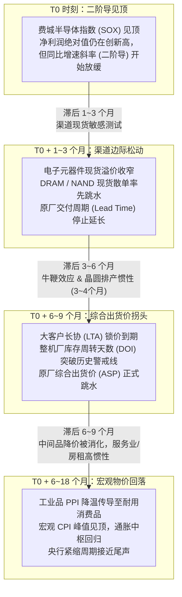
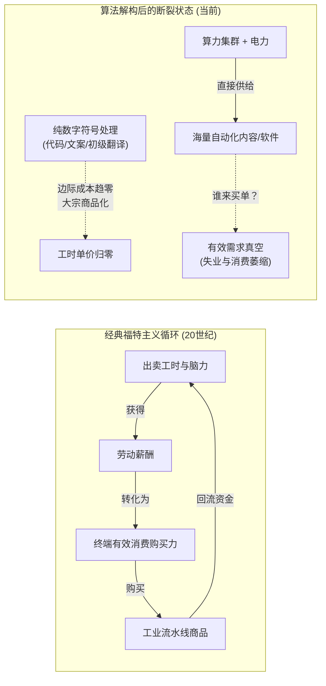
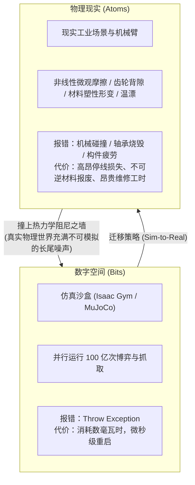
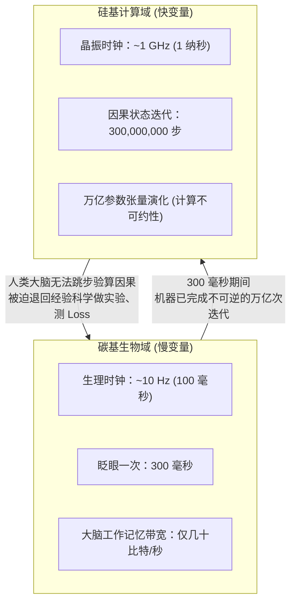
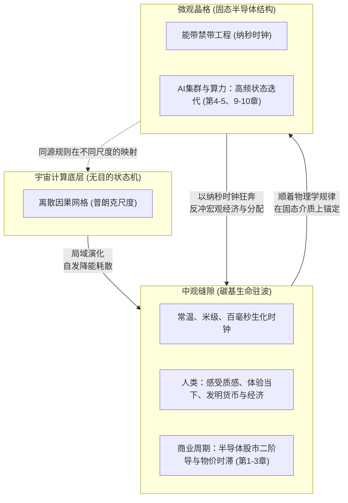

# 《半导体见顶了吗？》全文核心图表与模型设计指南

> **图表设计宗旨**：本文的图表不是配图或插画，而是全文论证体系的**“视觉数学证明”**与**“认知脚手架”**。每一个图表均对应一个跨学科的核心机制，帮助读者将高度抽象的物理学、信息论与金融学逻辑转化为直观的空间几何与动态流动。

---

## 全文图表总览与映射矩阵

| 图表编号 | 所属章节 | 图表全称 | 核心模型 / 理论工具 | 视觉形式 |
| :--- | :--- | :--- | :--- | :--- |
| **图 1-1** | 第 1 章 | 半导体二阶导定价与宏观物价传导时序图 | 股价前瞻时滞模型 / 牛鞭效应 | 宏观时序走势与传导齿轮图 |
| **图 2-1** | 第 2 章 | AI 军备竞赛的剪刀差与折旧悬崖瀑布模型 | 纳什均衡 / 资产使用寿命错配 | 剪刀差趋势与利润表折旧瀑布 |
| **图 3-1** | 第 3 章 | 福特主义闭环的断裂与价值原子化迁移图 | 宏观分配闭环 / 价值稀缺性相图 | 双循环对比与价值迁移象限图 |
| **图 4-1** | 第 4 章 | 边际效用刹车对比图：碳基饱和 vs. 硅基工具性收敛 | 生理受体饱和阈值 / 工具性收敛 | 效用导数曲线与目标递归图 |
| **图 5-1** | 第 5 章 | 具身智能的 Sim-to-Real 鸿沟与热力学阻尼相图 | 非线性接触力学 / 熵增单向性 | 虚拟-现实空间映射与阻尼阶梯 |
| **图 6-1** | 第 6 章 | 宇宙状态机的计算几何流形 | 数字物理学 / 离散因果网格 | 宇宙三层因果计算架构图 |
| **图 7-1** | 第 7 章 | 同源观察者的算力真子集与朗道尔测量反冲 | $C_{\text{obs}} \ll C_{\text{sys}}$ / 朗道尔极限 | 嵌套集合与信息-废热热力学图 |
| **图 8-1** | 第 8 章 | 实体与过程的松弛时间-采样窗口相图 | 粗粒化重整化 / 块状宇宙投影 | 二维对数相图（$\tau_{\text{obs}}$ vs $\tau_{\text{rel}}$） |
| **图 9-1** | 第 9 章 | 物理载体弛豫时间的相变之梯 | 固态能带禁带 / 介质相变 | 时间尺度阶梯轴（$10^{-1} \to 10^{-12}\text{s}$） |
| **图 10-1** | 第 10 章 | 8 个数量级时钟倒挂与黑箱计算不可约图 | 计算不可约性 / 观察者反转 | 对数时钟频段对比与展开图 |
| **图 11-1** | 第 11 章 | 跨尺度阻抗匹配：人机交互的三重重叠界面 | 信号去抖滤波 / 符号降维 / 焦耳共栖 | 三层重叠投影切片结构图 |
| **图 12-1** | 第 12 章 | 中观缝隙（The Mesoscopic Gap）三维参数相空间 | 基础物理常数相交 / 偶发催化剂 | 三维相空间低洼区域示意图 |
| **图 12-2** | 第 12 章 | 生命与智能的十阶演化阶梯与抽象层级跃迁 | 分层封装法则 / 碳硅正交共生 | 三幕式十阶抽象阶梯架构全景图 |
| **图 13-1** | 第 13 章 | 体验的双重时空卷积积分模型 | 主观体验时空积分方程（Qualia） | 双重积分渲染机制图 |
| **图 14-1** | 第 14 章 | 终局全景图：在不同尺度晶格中展开的同源规则 | 全文五幕因果闭环总括 | 多层驻波干涉全景图 |

---

## 第一部核心图表（宏观经济与资本物理学）

### 【图 1-1】半导体二阶导定价与宏观物价传导时序图
- **所属章节**：第 1 章
- **核心逻辑**：说明金融资产（二阶导）$\rightarrow$ 现货价格 $\rightarrow$ 综合合约（ASP/DOI）$\rightarrow$ 终端宏观 CPI 的阶梯式时滞传导。



- **图表排版建议**：
  - 上方为四个时序指标的波形叠加曲线图（SOX 曲线率先拐头，现货价格紧随其后，合约 ASP 滞后两个季度，CPI 曲线在最右侧峰值回落）；
  - 下方配以“牛鞭效应”与“晶圆制造物理排产时间（Cycle Time）”的物理齿轮啮合说明。

---

### 【图 2-1】AI 军备竞赛的剪刀差与折旧悬崖瀑布模型
- **所属章节**：第 2 章
- **核心逻辑**：可视化展示资本开支（CapEx）与软件 ARR（年化经常性收入）之间的剪刀差，以及 3~5 年算力硬件折旧对利润表的冲击。

```
【金额 / 增长率】
  ▲
  │                                           / 累计算力基础设施投入 (CapEx)
  │                                         /   (指数级陡峭爬坡)
  │                                       /
  │                                     /
  │  【剪刀差扩大】                    /
  │                                 /
  │                               / ─────────────────────────────────────
  │                             /     真实 AI 软件直接收入 (ARR)
  │                           /       (对数级平缓增长)
  │                         /
  │                       /
  │                     / 
  │───────────────────/─────────────────────────────────────────────────▶【时间】
  │                 T1 (狂热采购期)         T2 (折旧悬崖引爆点)
  │
  ▼ 【利润表冲击：折旧与摊销 (D&A) 瀑布】
  ┌─────────────────────────────────────────────────────────────┐
  │ 资产负债表：在建工程 ──▶ 固定资产 (3~5年物理/技术寿命)      │
  │ 利润表侵蚀：每年固定计提 20%~33% 硬件原值折旧                │
  │ 结果：营业利润率被动压缩，自由现金流 (FCF) 骤降             │
  └─────────────────────────────────────────────────────────────┘
```

---

### 【图 3-1】福特主义闭环的断裂与价值原子化迁移图
- **所属章节**：第 3 章
- **核心逻辑**：展示“福特主义宏观闭环”如何被趋零边际成本的算法所瓦解，以及经济价值如何向不可模拟的物理世界（Atoms）撤退。



- **价值迁移象限图（配图子模块）**：
  - **横轴**：数字世界（Bits） $\to$ 物理原子（Atoms）
  - **纵轴**：规则明确/可形式化（Standardized） $\to$ 利益博弈/不可模拟现场（Contextual & Accountable）
  - **第四象限（Bits + Standardized）**：初级代码、资料搬运、标准客服 —— **价值崩塌区**；
  - **第一象限（Atoms + Contextual）**：工程现场调试、物理系统集成、事故法律背书、真实信任枢纽 —— **极端溢价区**。

---

## 第二部核心图表（具身现实与热力学阻尼）

### 【图 4-1】边际效用刹车对比图：碳基饱和 vs. 硅基工具性收敛
- **所属章节**：第 4 章
- **核心逻辑**：对比人类欲望的生理饱和硬顶与 AI 目标函数的非饱和性。

```
【边际效用 dU/dR】
  ▲
  │
  │  硅基欲望 (工具性收敛)：
  │  ──────────────────────────────────────▶ 边际效用恒正 (无饱和点)
  │  (获取更多算力、更多电能、更强物理控制权)
  │
  │  碳基欲望 (生理生化受体)：
  │  ───╮
  │     ╰──╮
  │        ╰──╮
  │           ╰───╮ 边际效用递减 (受体饱和/寿命有限)
  │               ╰────────────────────────▶【资源摄入量 R】
  │                                     ▲
  │                               [生理饱和阈值]
  │                             (2500大卡/床宽2米/寿命百年)
```

---

### 【图 5-1】具身智能的 Sim-to-Real 鸿沟与热力学阻尼相图
- **所属章节**：第 5 章
- **核心逻辑**：对比纯数字仿真世界与冷酷物理现实的物理阻尼差距。



---

## 第三部核心图表（宇宙计算与信息论极限）

### 【图 6-1】宇宙状态机的计算架构图
- **所属章节**：第 6 章
- **核心逻辑**：用计算机体系结构解析物理学底层现象。

```
  ┌─────────────────────────────────────────────────────────────┐
  │                 宇宙底层计算系统架构                        │
  ├───────────────────────┬─────────────────────────────────────┤
  │ 物理学现象            │ 计算机科学/信息论对应映射           │
  ├───────────────────────┼─────────────────────────────────────┤
  │ 普朗克长度 (1.6x10⁻³⁵m)│ 机器的最小离散“空间像素网格”       │
  │ 普朗克时间 (5.4x10⁻⁴⁴s)│ 机器的单次“系统时钟周期脉冲”       │
  │ 真空中光速 (c)        │ 局域网相邻节点间状态传递的“总线带宽”│
  │ 量子态叠加 / 波函数坍缩│ 节约全局算力开销的“惰性求值策略”   │
  │ 热力学第二定律 (熵增)  │ 局域不可逆计算导致的“废热状态累积” │
  └───────────────────────┴─────────────────────────────────────┘
```

---

### 【图 7-1】同源观察者的算力真子集与朗道尔测量反冲
- **所属章节**：第 7 章
- **核心逻辑**：证明内生同源观察者为什么算不过全系统，以及测量行为的热力学代价。

```
               ┌──────────────────────────────────────────────────────────┐
               │                物理系统整体 (System)                     │
               │                                                          │
               │  状态空间大小: S_system                                  │
               │  系统总计算能力: C_system                                │
               │                                                          │
               │          ┌───────────────────────────────────┐           │
               │          │    内生同源观察者 (Observer)       │           │
               │          │                                   │           │
               │          │  物理载体占用系统粒子真子集       │           │
               │          │  可用算力: C_obs ≪ C_system       │           │
               │          │                                   │           │
               │          │  [试图观测系统]                   │           │
               │          └───────────────┬───────────────────┘           │
               │                          │ 写入 1 比特记录               │
               │                          ▼ 必须耗散能量                 │
               │               ┌───────────────────────┐                  │
               │               │ 朗道尔极限热排放      │                  │
               │               │ ΔQ ≥ k_B · T · ln 2   │                  │
               │               └──────────┬────────────┘                  │
               │                          │                               │
               │                          ▼ 改变系统微观状态              │
               │             [不可逆的反冲与热力学扰动]                   │
               └──────────────────────────────────────────────────────────┘
```

---

### 【图 8-1】实体与过程的松弛时间-采样窗口相图
- **所属章节**：第 8 章
- **核心逻辑**：证明“实体（名词）”与“过程（动词）”完全取决于观察者采样时间 $\tau_{\text{obs}}$ 与客体松弛时间 $\tau_{\text{rel}}$ 的相对比例。

```
【客体物理松弛时间 τ_rel】
  ▲
  │
  │  地质板块漂移 (10¹⁴ s) ───┐   【坚硬实体区】                ╱
  │                           │   (τ_obs ≪ τ_rel)             ╱
  │  花岗岩高山 (10¹² s) ─────┼─────────────────────────────╱─── 人类将高山感知为“实体”
  │                           │                           ╱
  │  人类机体寿命 (10⁹ s) ────┼─────────────────────────╱───────
  │                           │                       ╱
  │  神经电生化传导 (10⁻¹ s) ─┼─────────────────────╱─────────── 人类感知到流水与风
  │                           │                   ╱
  │  分子热碰撞 (10⁻¹² s) ────┼─────────────────╱   【湍流流体区】
  │                           │               ╱     (τ_obs ≫ τ_rel)
  │                           │             ╱
  │───────────────────────────┴───────────╱────────────────────────▶【观察者采样窗口 τ_obs】
  │                         10⁻¹ s      10⁹ s
  │                       (人类窗口)  (地质观察者)
```

---

## 第四部核心图表（晶格工程与时钟倒挂）

### 【图 9-1】物理载体弛豫时间的相变之梯
- **所属章节**：第 9 章
- **核心逻辑**：半导体能带工程如何在微观马尔可夫热混沌中锚定纳秒确定性结构，实现从生化分子扩散到电子漂移的物理相变。

```
【弛豫时间 τ】
  ▲
  │  10⁻¹ s (100毫秒) ─── 生物神经化学网络 (Na⁺/K⁺ 离子跨膜流动、蛋白质分子构型翻折)
  │                        │
  │                        ▼ 【跨越 7~8 个数量级的介质相变】
  │                        │
  │  10⁻⁹ s (1纳秒)   ─── 固态半导体晶格 (禁带阻断常温热涨落、漂移电子高速导通)
  │                        │
  │  10⁻¹² s (1皮秒)  ─── 声子振动与飞秒激光相互作用 (前沿超快光学计算)
  ▼
```

---

### 【图 10-1】8 个数量级时钟倒挂与黑箱计算不可约图
- **所属章节**：第 10 章
- **核心逻辑**：人类创造沙盒本欲为“神”，却因时钟尺度倒挂而成为机器面前的“低算力盲人”。



---

### 【图 11-1】跨尺度阻抗匹配：人机交互的三重重叠界面
- **所属章节**：第 11 章
- **核心逻辑**：展示两个不同特征频率的物理系统如何通过工程界面相互察觉。

```
                     ┌────────────────────────────────────────┐
                     │          人 机 碰 撞 重 叠 带          │
                     └───────────────────┬────────────────────┘
                                         │
     ┌───────────────────────────────────┼───────────────────────────────────┐
     ▼                                   ▼                                   ▼
【信号物理换能层】                  【语义离散符号层】                  【宏观热力学共栖层】
• 输入端：硬件去抖与锁存            • 机器高维张量几何流形              • 共享行星表面同一散热池
  (慢速连续动作 ──▶ 纳秒触发)          │ 强制投影坍缩                      • 争夺同一电网输送的电子
• 输出端：60Hz 帧缓冲低通滤波          ▼                                   • 共同承受材料物理老化极限
  (纳秒浮点运算 ──▶ 50ms暂留)       • 一维离散语言 Token 串流
                                      (人类肉身间低维有损协议)
```

---

## 第五部核心图表（中观驻波与体验积分）

### 【图 12-1】中观缝隙（The Mesoscopic Gap）与相空间局域势阱
- **所属章节**：第 12 章
- **核心逻辑**：破除碳基沙文主义。展示 300K/1m/100ms 并非全宇宙智能自组织的普适黄金通道，而是碳水化合物在行星表面的局域相变势阱；异质尺度结构由于零重叠互为物理幽灵，尺度重叠带（Overlap）是因果察觉与理解的充要条件。

```
                 【空间尺度 L】
                     ▲
                     │  光年级 (10¹⁶ m)：星系间大尺度 MHD 磁流体结构 [时钟以百万年计，对人类呈死寂凝固态]
                     │
                     │      ┌───────────────────────────────┐
                     │      │  中观缝隙 (碳水化合物局域势阱) │
                     │      │  L ~ 10⁰ m (米级机械力矩平衡) │
                     │      │  T ~ 300 K (常温弱氢键流变)   │
                     │      │  τ ~ 10⁻¹ s (水合离子膜电位)  │
                     │      └───────────────────────────────┘
                     │
                     │  飞秒级 (10⁻¹⁵ m)：中子星核面条 QCD 强相互作用结构 [时钟以飞秒计，对人类平均为白噪声]
                     └────────────────────────────────────────▶【温度 T】
                    10⁻³ K                   300 K           10⁶ K
                 (深空极低温 BEC)        (常温液态水)     (中子星强相互作用)
              宏观相干长程极化激元       碳水生命驻波     夸克-胶子核物质拓扑

   【核心法则】：两类稳定结构只有在相空间存在【尺度重叠带 (Overlap)】时，方能产生因果感知与测量交互！
```

---

### 【图 12-2】生命与智能的十阶演化阶梯与抽象层级跃迁
- **所属章节**：第 12 章
- **核心逻辑**：以耗散结构与分层封装法则为红线，展现从碱基对（L1）到行星级全球脑（L10）的三幕式演化进程，论证高阶算力对低阶心智的正交共生而非淘汰。

```
【十阶演化阶梯与三幕式跃迁全景】

【第三幕：行星级共生与合成演化】
  L10 行星级全球脑 (Noosphere) ── 碳硅共生体 (百亿人类意图源 + 硅基AGI高维张量超压缩)
                                 演化突变：代际生化淘汰 (Generation) ➔ 软件算法工程迭代 (Version)
────────────────────────────────────────────────────────────────────────────────
【第二幕：组织特化到个体心智涌现】
  L9  个体心智 (Mind & Brain) ── 千亿突触时空积分、前馈世界建模、感受质 (Qualia) 与体外文化
  L8  系统 (NEI Network)      ── 神经-内分泌-免疫长程负反馈回路、机体宏观稳态 (Homeostasis)
  L7  器官 (Organs)           ── 异质组织拓扑几何耦合、生物精密仪器 (泵血/呼吸/解毒)
  L6  组织 (Tissues)          ── 同类细胞集群特化、宏观力矩与高带宽电信号传导
────────────────────────────────────────────────────────────────────────────────
【第一幕：微观基元到生物物理闭环】
  L5  细胞 (Single Cells)     ── 硬件与指令自我指涉闭环、自主复制与原始生存意志
  L4  细胞器 (Organelles)     ── 脂质双分子层微区分隔、空间并发代谢与跨膜离子梯度
  L3  蛋白质 (Proteins)       ── 3D折叠构象、纳米机械做功、酶催化加速 10⁶~10¹² 倍
  L2  基因 (Genes)            ── 启动子/外显子/内含子模块化 If-Then 指令集与自适应算法
  L1  碱基对 (Base Pairs)     ── A-T/C-G 氢键特异性结合、香农纠错与跨地质年代信息持久化
════════════════════════════════════════════════════════════════════════════════
【核心法则】：分层封装法则 (低阶封装为基础设施) ＋ 正交共生法则 (硅基GHz/高维 ⟂ 碳基百毫秒/物理接地)
```

---

### 【图 13-1】主观体验的时空双重卷积积分模型（Qualia 方程可视化）
- **所属章节**：第 13 章
- **核心逻辑**：可视化主观体验的数学物理本质——时空卷积对微观离散事件的滑动平均滤波。

$$E(t) = \int_{\Omega} \int_{t - \tau}^{t} K(\mathbf{x}, t - t') S(\mathbf{x}, t') \, dt' d\mathbf{x}$$

```
                【微观离散物理事件流 S(x, t)】
                (量子涨落、分子无规则碰撞、离散光子吸收)
                                 │
                                 ▼
    ┌─────────────────────────────────────────────────────────────┐
    │              生物机器的双重滑动平均滤波器                    │
    ├─────────────────────────────┬───────────────────────────────┤
    │ 空间积分核：机体外表面 Ω     │ 时间积分核：本真现在窗口 τ     │
    │ (~1.5-2.0 m² 皮肤与传感阵列)│ (~50 - 100 毫秒)              │
    ├─────────────────────────────┼───────────────────────────────┤
    │ • 抹平微观单分子碰撞尖刺    │ • 消除瞬时切片 (δt→0) 物理死寂│
    │ • 宏观涌现：丝绸的光滑      │ • 残影叠合涌现：速度与流动    │
    │ • 宏观涌现：咖啡的温热      │ • 声压序列涌现：语言与旋律    │
    │ • 宏观涌现：花朵的色彩      │ • 因果时序涌现：直觉因果律    │
    └─────────────────────────────┴───────────────────────────────┘
                                 │
                                 ▼
                 【渲染结果：主观体验与活着的当下】
```

---

### 【图 14-1】终局全景图：在不同尺度晶格中展开的同源规则
- **所属章节**：第 14 章
- **核心逻辑**：全文闭环总揽图。说明半导体周期、AI狂潮、宇宙物理与人类心灵是同一种规则在不同频段上的相互拍击。



---

## 印刷与视觉呈现技术规范

1. **色彩哲学（双色套印推荐）**：
   - **冷色系（硅基与宇宙计算）**：采用深钴蓝或玄武岩灰，用于代表数据中心、半导体能带、拉普拉斯算力不等式及离散时空网格；
   - **暖色系（碳基与中观体验）**：采用暖赭石或琥珀金，用于代表人体时空积分窗口、感受质（Qualia）、福特主义工资流与宏观物价波动。
2. **公式呈现原则**：
   - 全文数学物理公式一律采用标准 LaTeX 格式排版，公式周围保留充足留白，并在正文中紧跟其“直觉物理图像”解释，绝不堆砌无物理意义的纯代数推演。
3. **图文互文规范**：
   - 每一幅图在正文中必须至少有专门的一个小节进行“读图引导”，先讲图示的几何直觉，再推导背后的现实困境，最后给出跨学科的破局结论。
